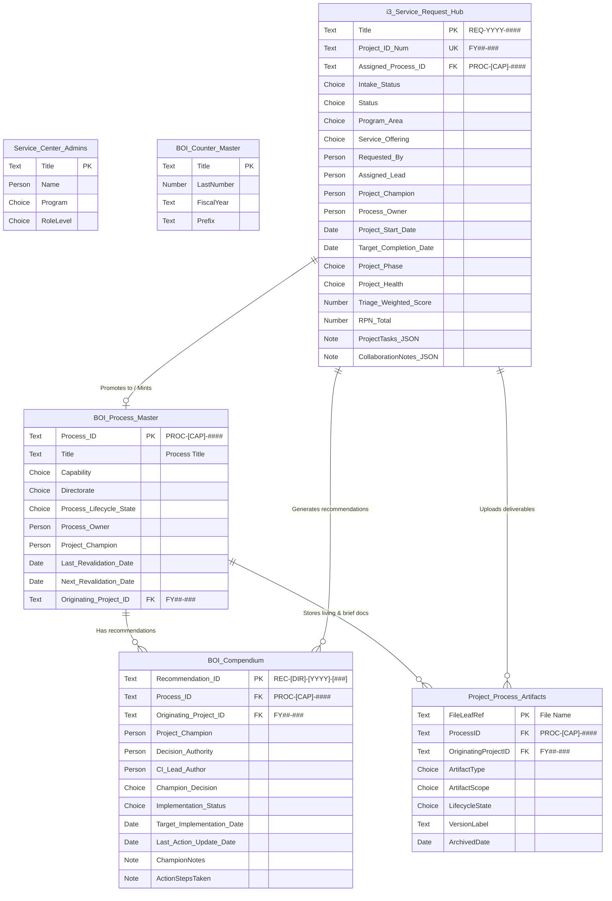
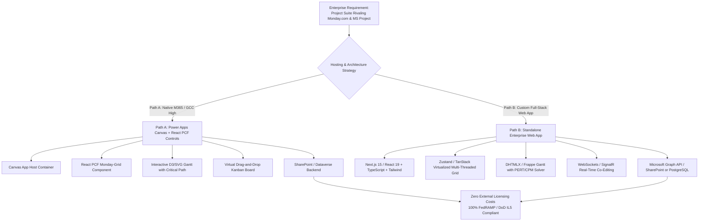

# Enterprise Efficiency Service Center: Master Architecture & Technical Implementation Blueprint

---

## 1. Executive Summary & Architectural Verdict

### 1.1 Architectural Verdict: Separated Full-Width Views vs. Split Page
The design decision to maintain **Separated Full-Width Views** (sharing a unified screen shell and linked via bidirectional contextual deep-links) rather than cramming both the **Process & Artifact Repository** and the **Recommendations Compendium** into a single 35%/65% split page is **architecturally validated and strongly endorsed**.

| Architectural Dimension | 35% / 65% Combined Split Page | Separated Views with Contextual Deep-Links | Verdict & Rationale |
| :--- | :--- | :--- | :--- |
| **Security & Access Boundary** | High risk of UI confusion: general agency users (Read-only access) stare at an empty, disabled, or locked Compendium panel. | Clean boundary separation: general agency users view full-width Process & Artifact catalog; Compendium is restricted to Process Owners, Champions, Decision Authorities, and BOI Admins. | **Separated Wins**: Prevents RLS permission leaks and user frustration over locked UI regions. |
| **Information Density & Ergonomics** | Severe cramping: 65% pane must host a 4-column metadata strip, living operational artifacts, historical project briefs, superseded accordion, *plus* a multi-column Compendium table. | Zero horizontal scrolling: Process Profile gets generous breathing room (tables, badges, metadata); Compendium gets full 1,366px+ width for decisions, status, notes, and action logs. | **Separated Wins**: Eliminates nested scrollbars and truncated tabular columns. |
| **Navigation & Flow Velocity** | Users lose visual hierarchy; context switching between process inspection and recommendation adjudication causes scroll fatigue. | Seamless 1-click transition: Process card features `💡 View Process Recommendations (N) →` pill; Compendium features `← View Process PROC-XX-####` pill. | **Separated Wins**: Retains focused mental models while enabling instant bidirectional traversal. |
| **Delegation & Performance** | Heavy single-screen collections and parallel queries against 5 lists simultaneously degrade initial screen render time. | Lazy loading: `BOI Compendium` items are queried and filtered only when navigating to `Recommendations`, preserving App.OnStart and screen transition speed. | **Separated Wins**: Significant memory footprint and DOM render savings in Power Apps. |

```mermaid
flowchart LR
    subgraph ProcessLibraryView ["Full-Width Process Library View (varLibraryTab = 'Processes')"]
        A[Process Directory List\n350px left rail] --> B[Process Profile Card\nFull-width right pane]
        B --> C[Living Approved Artifacts]
        B --> D[Historical Project Briefs]
        B --> E[Superseded Files Accordion]
        B -->|Stakeholder Pill Badge\n💡 View Recommendations (N) →| F(Context Switch:\nSet varLinkedProcessFilter)
    end

    subgraph CompendiumView ["Full-Width Compendium View (varLibraryTab = 'Recommendations')"]
        G[Compendium Filter Bar\nStatus | Champion | Capability] --> H[Compendium Data Gallery\nFull-width rows with RLS]
        H --> I[Decision Dropdown\nAccept / Reject / Defer / Modify]
        H --> J[Action Steps & Audit Notes Log]
        H -->|Clickable Process Badge\n← View Process PROC-SEC-0008| K(Context Switch:\nSet varSelectedProcessFromRec)
    end

    F -->|Switches Tab & Filters| CompendiumView
    K -->|Switches Tab & Highlights| ProcessLibraryView
```

---

## 2. Master Unified Requirements Traceability Matrix (RTM)

This consolidated matrix integrates all baseline capabilities, the 13 new requirements, Project Closeout Confirmation Modal, Analyst-Free Self-Certification, Bidirectional Linking, Two-Way Requestor-Fulfiller Collaboration Stream, and Visual Gantt Timeline Tracking.

### 2.1 Security, Access Control, Navigation & Architecture (SEC)
| Req ID | Business & Functional Requirement | SharePoint List & Columns | Power Apps Screen / Controls / Power Fx | Power Automate Flow | Verification & Acceptance Test |
| :--- | :--- | :--- | :--- | :--- | :--- |
| **RTM-SEC-01** | **Role Gatekeeping**<br>Identify BOI Service Center Staff, Champion Network, and General Requestors at startup. | `Service_Center_Admins`<br>Cols: `Title`, `Name` (Person), `Program`, `RoleLevel` | `App.OnStart`:<br>`Set(varCurrentUser, User()); Set(varAdminRecord, LookUp(Service_Center_Admins, Lower(Name.Email) = Lower(User().Email))); Set(varIsAdmin, !IsBlank(varAdminRecord)); Set(varUserRole, Coalesce(varAdminRecord.Program.Value, "General Agency"));` | N/A | Log in as BOI staff vs. regular employee; verify top header profile pill (`lblUserRoleText`) and left navigation reflect correct role permissions. |
| **RTM-SEC-02** | **URL Deep-Linking & View Isolation**<br>Support URL query params (`?view=intake`, `?view=library`, `?view=compendium`, `?view=reval&procID=...`) while hiding navigation rail for embedded/direct access. | N/A (URL Parameters) | `App.StartScreen`:<br>`Switch(Param("view"), "intake", scrIntakeHub, "library", scrLibraryAndCompendium, "compendium", scrLibraryAndCompendium, "projects", scrProjectWorkspace, scrIntakeHub)`<br>`conLeftNavSidebar.Visible`: `IsBlank(Param("view"))` | Embedded in email notifications (Flows 2, 4, 5, 6) | Access `?view=intake` as end user; verify left navigation rail is collapsed and screen opens directly to the intake form. |
| **RTM-SEC-03** | **Persistent Left Navigation Rail & Shell Header**<br>230px dark navy sidebar, search bar, notification bell, user avatar, and breadcrumbs. | `Office365Users`<br>`Service_Center_Admins` | Controls: `conShellContainer`, `conLeftNavSidebar`, `galNavItems`, `conTopBar`, `imgUserAvatar`, `txtGlobalSearch` | N/A | Click each navigation item (Intake Hub, Active Projects, Process Library, Recommendations, Reports, Knowledge Center, Admin); verify active highlight transitions smoothly. |
| **RTM-SEC-04** | **Sparse List Validation Rule**<br>Keep all 40+ Tier 2 columns set to `Required = No` in SharePoint; validate dynamically in Power Apps per active module container. | `'i3 Service Request Hub'`<br>(All 40+ Tier 2 columns) | `btnSubmitIntake.DisplayMode`:<br>`If(IsBlank(txtReqSummary.Text) \|\| IsBlank(drpServiceOffering.Selected.Value) \|\| (varActiveModule = "GPC" && IsBlank(txtCardholderName.Text)), DisplayMode.Disabled, DisplayMode.Edit)` | N/A | Submit a GPC request leaving CI/IPM fields blank; confirm zero missing-column exceptions are thrown by SharePoint. |
| **RTM-SEC-05** | **Compendium Row-Level Security (RLS)**<br>Strictly isolate recommendation records to assigned Process Owner, Champion, Decision Authority, and BOI Admins at UI and API layers. | `'BOI Compendium'` (`Process ID`, `Project Champion`, `Decision Authority`, `CI Lead Author`)<br>`'BOI Process Master'` (`Process Owner`) | `galCompendiumItems.Items`:<br>`Filter('BOI Compendium', varIsAdmin \|\| Lower('Project Champion'.Email) = Lower(varCurrentUser.Email) \|\| Lower('Decision Authority'.Email) = Lower(varCurrentUser.Email) \|\| Lower(LookUp('BOI Process Master', 'Process ID' = 'Process ID').'Process Owner'.Email) = Lower(varCurrentUser.Email))` | **Flow 5**: Breaks item inheritance (`breakroleinheritance(copyRoleAssignments=false)`) and assigns explicit read/write claims. | Log in as an uninvolved employee; verify gallery renders 0 records and direct SharePoint URL returns Access Denied. |

### 2.2 Demand Management & Universal Intake (DM)
| Req ID | Business & Functional Requirement | SharePoint List & Columns | Power Apps Screen / Controls / Power Fx | Power Automate Flow | Verification & Acceptance Test |
| :--- | :--- | :--- | :--- | :--- | :--- |
| **RTM-DM-01** | **Enterprise Demand Front Door**<br>Centralized intake supporting CI, IPM, ICC, and EGR. | `'i3 Service Request Hub'`<br>Cols: `Title`, `Date Submitted`, `Requested By`, `Intake Status`, `Status` | `scrIntakeHub`<br>Container: `conNewIntakeFormView`<br>Form mode toggle: `varIntakeViewMode = "New"` | **Flow 2**: Mints sequential `REQ-YYYY-####` and sends confirmation receipt. | Submit new intake; confirm record creation and unique `REQ-YYYY-####` assigned. |
| **RTM-DM-02** | **Standard Baseline Capture (Tier 1)**<br>Capture baseline fields across all requests regardless of service type. | `'i3 Service Request Hub'`<br>Cols: `Title`, `Service Offering`, `Component-Directorate`, `Desired Completion Window`, `Known Stakeholder(s)`, `Project Champion`, `Request Summary` | Container: `conBaselineFields`<br>Required indicator on fields; real-time validation banner. | N/A | Attempt submission with blank summary; verify submit button remains disabled with warning tooltip. |
| **RTM-DM-03** | **Service-Driven Auto-Mapping**<br>Customer selects Service Offering; system maps `Program Area` and `Target Program Team` automatically. | `'i3 Service Request Hub'`<br>Cols: `Service Offering`, `Program Area`, `Target Program Team` | `drpServiceOffering.OnChange`:<br>`Switch(Self.Selected.Value, "Government Purchase Card", UpdateContext({varAutoProg: "ICC", varAutoTeam: "Internal Controls Team"}), "Innovation Management", UpdateContext({varAutoProg: "IPM", varAutoTeam: "Portfolio Team"}), ...)` | **Flow 2**: Routes alert email to mapped target team. | Select "Government Purchase Card"; verify customer sees no Program prompt, and SharePoint patches `Program Area` = "Internal Control and Compliance". |
| **RTM-DM-04** | **Tier 2 Progressive Disclosure Modules**<br>Dynamically show questions specific to selected Service Offering. | `'i3 Service Request Hub'`<br>Tier 2 module-specific columns | Containers: `conCI_Module`, `conIPM_Module`, `conInnovation_Module`, `conGPC_Module`, `conCUEC_Module`, `conEGR_Module`<br>`Visible` bound to `varActiveModule`. | N/A | Toggle between Service Offerings; verify appropriate module card appears smoothly without resetting Tier 1 baseline data. |
| **RTM-DM-05** | **Submitter "My Requests" Tracker & Clarification Loop**<br>Track submitted requests in real time, post clarification notes, and trigger immediate bidirectional email notifications upon note submission. | `'i3 Service Request Hub'`<br>Cols: `Requested By`, `Status`, `Intake Status`, `CollaborationNotes_JSON` | Container: `conMySubmittedRequests`<br>`galMyRequests.Items`: `Filter('i3 Service Request Hub', Lower('Requested By'.Email) = Lower(varCurrentUser.Email))`<br>Integrated `conNotesStream` clarification pane with immediate dispatch. | **Flow 6**: Dispatches instant bidirectional email alert to the opposite party (Requestor $\leftrightarrow$ Assigned Lead) the moment a note is posted. | Open "Track My Requests", post a note to a ticket; verify assigned fulfiller receives an immediate email alert with deep-link, and status updates appropriately. |
| **RTM-DM-06** | **Draft Saving & Duplicate Process Warning**<br>Save incomplete intake as draft; warn in real time if active project exists for target process. | `'i3 Service Request Hub'`<br>Cols: `Intake Status` ("Draft"), `Target Process ID`, `Assigned Process ID` | `btnSaveDraft.OnSelect`: Patches record with `Intake Status: {Value: "Draft"}`.`<br>`lblDuplicateWarning.Visible`: `!IsBlank(LookUp('i3 Service Request Hub', 'Assigned Process ID' = txtTargetProcessID.Text && Status.Value <> "Closed"))` | N/A | Enter a process ID with an active project; verify amber banner displays: "⚠️ Notice: An active project is currently open for this Process." |
| **RTM-DM-07** | **Submitter View Isolation & Privacy Boundary**<br>Submitters must strictly see only their submitted intake(s) and live status. Aggregate intake counts and program KPI cards are hidden. Internal Risk Triage, 20Q questionnaire, and SIPOC tabs are hidden. Two-way collaboration messaging stream is preserved for real-time customer updates. | `'i3 Service Request Hub'`<br>Cols: `Requested By`, `Status`, `Intake Status`, `CollaborationNotes_JSON` | `conIntakeKpiContainer.Visible`: `varIsAdmin`<br>`conSubmitterWelcome.Visible`: `!varIsAdmin`<br>`galIntakeQueue.Items`: `If(!varIsAdmin, Filter('i3 Service Request Hub', Lower('Requested By'.Email) = Lower(varCurrentUser.Email)), Filter('i3 Service Request Hub', ...))`<br>`conTriageTabs.Visible`: `varIsAdmin` | **Flow 6**: Dispatches bidirectional alerts between Submitter and Assigned Lead. | Log in as Alex Kim (submitter); verify KPI cards are hidden, queue shows only Alex Kim's intake, Risk & SIPOC tabs are hidden, and collaboration stream allows posting notes. |

### 2.3 Fulfiller Queue, Direct Work & CI/IPM Triage Studio (TRG)
| Req ID | Business & Functional Requirement | SharePoint List & Columns | Power Apps Screen / Controls / Power Fx | Power Automate Flow | Verification & Acceptance Test |
| :--- | :--- | :--- | :--- | :--- | :--- |
| **RTM-TRG-01** | **Interactive KPI Filter Cards & Queue Search**<br>Live counters for Open (14), CI (6), IPM (3), ICC (3), EGR (2). | `'i3 Service Request Hub'`<br>Cols: `Intake Status`, `Program Area`, `Component-Directorate` | `conKPIRow`: 5 clickable cards setting `varQueueFilter`.<br>`galIntakeQueue.Items`: Filtered by search text, component dropdown, and active KPI filter card. | N/A | Click "CI" KPI card; confirm count matches card (6) and queue filters instantly. |
| **RTM-TRG-02** | **Non-Triage Direct Work & Closeout (ICC & EGR)**<br>Bypass multi-tab triage for direct consulting/reporting; fulfillers resolve directly from Request tab. | `'i3 Service Request Hub'`<br>Cols: `Assignee`, `Status` ("Closed"), `Resolution / Reason Closed`, `Project Status Notes` | Container: `conDirectCloseIC_EGR` inside `conSubTab_Request`.<br>`btnCloseDirect.OnSelect`: Patches status to "Closed", stamps completion notes. | **Flow 6**: Sends resolution email to requestor. | Open ICC request, type resolution notes, click "Complete & Close"; confirm item closes directly without creating an active project workspace. |
| **RTM-TRG-03** | **CI & IPM Triage Studio & Delivery Tier Model**<br>4-tab Studio (Request, Risk & Triage, SIPOC, Charter & Promotion) to decide Own (Tier 3), Assist (Tier 2), or Advise (Tier 1). | `'i3 Service Request Hub'`<br>Cols: `Triage Decision Disposition`, `Dedicated Team Resource Model`, `Assigned Lead` | Container: `conRightTriageCard`<br>Tab pills: `galTriageSubTabs` toggling containers `conSubTab_Request`, `conSubTab_RiskTriage`, `conSubTab_SIPOC`, `conSubTab_Charter`. | N/A | Cycle through all 4 sub-tabs; verify form inputs, score summaries, and promote actions render accurately. |
| **RTM-TRG-04** | **20-Question Diagnostic Triage Popup**<br>Modal with 20 sliders (1–5 scale across 5 weighted categories) computing 0–100 composite score. | `'i3 Service Request Hub'`<br>Cols: `Triage Q01`–`Triage Q20`, `Cat 1 Subtotal`–`Cat 5 Subtotal`, `Triage Weighted Score` | Modal: `conModal20Q`<br>Controls: `sldQ01`–`sldQ20`, `lblTotalScoreNumber`, horizontal category bars (`galCategoryBars`), `btnApply20QScores`. | N/A | Adjust 20 sliders and click Apply; verify composite score (e.g. 72/100) and 5 progress bars update in real time. |
| **RTM-TRG-05** | **FMEA RPN Capture & Safety Override**<br>Severity (1–5), Occurrence (1–5), Detection (1–5) $\rightarrow \text{RPN} = S \times O \times D$. Safety override if $\text{RPN} \ge 64$ or $S = 5$. | `'i3 Service Request Hub'`<br>Cols: `RPN Severity`, `RPN Occurrence`, `RPN Detection`, `RPN Total` | Dropdowns: `drpRPN_S`, `drpRPN_O`, `drpRPN_D`.<br>`lblRPNScore.Text`: `drpRPN_S.Selected.Val * drpRPN_O.Selected.Val * drpRPN_D.Selected.Val`. Tier override indicator. | N/A | Set $S=5, O=3, D=3$ ($\text{RPN}=45$); verify safety rule elevates Delivery Tier from Advise (Tier 1) to Assist (Tier 2). |
| **RTM-TRG-06** | **High-Level SIPOC Capture**<br>Capture Suppliers, Inputs, Process, Outputs, Customers during triage. | `'i3 Service Request Hub'`<br>Cols: `Draft SIPOC - Suppliers`, `Inputs`, `Process`, `Outputs`, `Customers` | Sub-tab 3 (`conSubTab_SIPOC`): 5 structured multi-line text controls with auto-save. | N/A | Enter SIPOC entries during triage session; verify data saves to SharePoint and carries over upon project promotion. |
| **RTM-TRG-07** | **Cross-Program Re-Routing Hand-Off**<br>Re-route misclassified intakes to a different program area without losing data. | `'i3 Service Request Hub'`<br>Cols: `Program Area`, `Target Program Team`, `Project Status Notes` | Control: `drpReassignProgram` inside Request tab.<br>`OnChange`: Patches new Program Area and appends note to `CollaborationNotes_JSON`. | **Flow 2**: Dispatches alert to newly assigned program lead. | Reassign request from CI to ICC; confirm item transitions to ICC queue and KPI cards refresh automatically. |

### 2.4 Active Project Management Suite & Timeline Engine (PM)
| Req ID | Business & Functional Requirement | SharePoint List & Columns | Power Apps Screen / Controls / Power Fx | Power Automate Flow | Verification & Acceptance Test |
| :--- | :--- | :--- | :--- | :--- | :--- |
| **RTM-PM-01** | **Project Promotion & Auto-Generated ID**<br>Promote accepted CI/IPM intake, generating `Project ID #` (`FY##-###`) and `Assigned Process ID` (`PROC-[CAP]-####`). | `'i3 Service Request Hub'`<br>Cols: `Intake Status` ("Accepted"), `Project ID #`, `Assigned Process ID`, `Promoted to Library` | Button: `btnAcceptAndPromote.OnSelect`.<br>Transitions context to `scrProjectWorkspace` with newly promoted project loaded. | **Flow 1 & 2**: Atomic ID generation (`Concurrency = 1`) against fiscal calendar (Oct 1–Sep 30). | Promote intake; verify it exits intake queue, receives `FY27-005` and `PROC-SEC-0008`, and opens in Active Projects. |
| **RTM-PM-02** | **Schedule Dates, Lead & Stakeholder Management**<br>Manage Start Date, Target End Date, Responsible Lead, Champion, and Process Owner. | `'i3 Service Request Hub'`<br>Cols: `Project Start Date`, `Target Completion Date`, `Assigned Lead`, `Project Champion`, `Known Stakeholder(s)`, `Project Health` | Header card `conProjectSelectorCard`: `drpSelectProject`, `dtProjectStart`, `dtProjectEnd`, `cmbProjectLead`, `cmbStakeholders`, `drpProjectHealth`. | N/A | Modify Start/End dates and project lead; verify metadata bar and Gantt timeline recalculate instantly. |
| **RTM-PM-03** | **Tasks & Milestones Checklist with Multi-Scale Gantt Zoom Toggle**<br>Manage tasks with Status, Task Name, Due Date, Owner, and live progress bar, paired with an SVG Gantt chart featuring fixed zoom toggles (30 Days, 60 Days, 90 Days, Full Scope). | `'i3 Service Request Hub'`<br>Col: `ProjectTasks_JSON` (Plain Text JSON) | Controls: `conTasksHeaderRow`, `recProgressFill`, `lblProgressPct`, `galProjectTasks`, `chkTaskDone`, `btnAddTask`, `conGanttZoomToggle` (`varGanttZoom`), `htmlGanttVisualizer`. | N/A | Add task, toggle Gantt zoom between 30D, 60D, 90D, and Full Scope; verify timeline scales dynamically and task dates clamp accurately. |
| **RTM-PM-04** | **Pointed Interlocking SVG Phase Chevrons**<br>Visual interactive chevrons (1. Discovery, 2. Execution, 3. Quality Review, 4. Closure) with auto-milestone logging. | `'i3 Service Request Hub'`<br>Cols: `Project Phase`, `ProjectTasks_JSON` | Gallery: `galPhaseChevrons` with SVG polygon styling.<br>`btnClickChevron.OnSelect`: Validates phase transition and appends milestone to checklist. | **Flow 6**: Notifies requestor and stakeholders of phase milestone. | Click "2. Execution" chevron; verify chevron turns solid blue, "1. Discovery" shows checkmark (`✓`), and milestone is appended. |
| **RTM-PM-05** | **Artifact Upload, State Lifecycle & Archive Removal**<br>Upload deliverables with lifecycle state (`Draft / Working`, `Active`, `Current / Approved [Final]`, `Superseded / Archived`). | `Project_Process_Artifacts`<br>Cols: `Name`, `ProcessID`, `OriginatingProjectID`, `ArtifactType`, `LifecycleState`, `VersionLabel` | Controls: `galProjectArtifacts` (Strict filter: `OriginatingProjectID = varCurrentProject.'Project ID #' && LifecycleState.Value <> "Superseded / Archived"`), `drpArtifactState`, `conModalUpload`. | **Flow 3**: Binary upload, metadata stamping, auto-supersedes prior version of living operational assets. | Change an artifact's state dropdown to "Superseded / Archived"; confirm it immediately disappears from active table and appears in Process Library archive. |
| **RTM-PM-06** | **Project Closeout Confirmation Modal & Gate Check**<br>Formal closeout modal validating deliverables, checking recommendations, and updating Process Master revalidation dates. | `'i3 Service Request Hub'` (`Status` = "Closed", `Project Phase` = "Closeout")<br>`'BOI Process Master'` (`Last Revalidation Date`, `Next Revalidation Date`, `Process Lifecycle State`) | Modal: `conModalConfirmCloseout` (Visible = `varShowCloseoutModal`).<br>Checks approved artifact counts, open tasks, and logged recommendations before committing. | **Flow 6**: Sends formal Project Closeout Summary email to requestor, champion, and process owner. | Click "4. Closure" chevron; confirm confirmation modal opens, displays closeout checklist, and upon confirmation updates Process Master dates (`+365` days). |
| **RTM-PM-07** | **Two-Level Active Projects Architecture (Portfolio $\rightarrow$ Workspace)**<br>Landing on Active Projects displays an All-Projects Portfolio Directory displaying overall status, project lead, dates, and dynamic completion percentage bars. Clicking a project card drills down into the Detailed Project Workspace with a dedicated `[ ← Back to All Projects Portfolio ]` return action. | `'i3 Service Request Hub'`<br>Cols: `Project ID #`, `Title`, `Program Area`, `Assigned Lead`, `Status`, `Project Phase`, `ProjectTasks_JSON` | View containers: `conProjectsOverview` (Level 1) vs `conProjectDetailWorkspace` (Level 2).<br>Progress bar: `Round(CountRows(Filter(JSONTasks, done = true)) / CountRows(JSONTasks) * 100, 0) & "%"`<br>Back action: `UpdateContext({varProjectViewLevel: 1})` | N/A | Navigate to Active Projects; verify summary portfolio cards render with live percentage bars. Click card; verify detail workspace opens. Click back; verify return to portfolio. |
| **RTM-PM-08** | **Project Stakeholders & Governance Team Management**<br>Detailed Project Workspace features an explicit Governance Team card displaying Project Champion, CI/PM Staff Lead, Process Owner, Decision Authority, and Working Group tags, paired with an interactive `[ 👤 Manage Stakeholders ]` modal. | `'i3 Service Request Hub'`<br>Cols: `Project Champion`, `Assigned Lead`, `Process Owner`, `Decision Authority`, `GovernanceTeam_JSON` | Card: `conGovernanceTeamCard` with Champion, Lead, Owner, and Decision Authority.<br>Modal: `conModalManageStakeholders` (Visible = `varShowStakeholdersModal`).<br>Patch: Updates governance fields in SharePoint list. | N/A | Click `[ 👤 Manage Stakeholders ]`; update Champion or Decision Authority; verify card and SharePoint record update immediately. |
| **RTM-PM-09** | **Role Permissions on Active Projects (Edit vs. Read-Only)**<br>Only CI/PM Staff and Individuals in the CI Cohort can edit or update a project (tasks, phases, artifacts, staged recs, stakeholders, closeout). All other users (Requestors, Process Owners, general staff) have strictly read-only access with a clear View-Only banner. | `Service_Center_Admins`<br>Cols: `Name`, `Program`, `Role` | `varCanEditProject`: `varUserRole in ["Continuous Improvement", "Integrated Project Management", "Champion Network / Cohort"]`<br>Banner: `conReadOnlyBanner.Visible = !varCanEditProject`<br>Control Editability: Task checkboxes, phase chevrons, upload buttons disabled/hidden for read-only users. | N/A | Log in as Process Owner Avery Patel; open project; verify amber View-Only banner is displayed and task edit buttons are hidden/disabled. |
| **RTM-PM-10** | **My Assigned Projects Queue & Role-Based Filtering**<br>Provide a segmented queue switcher in the Portfolio Directory (`All Active Projects` vs. `My Assigned Projects`). The assigned queue dynamically filters to initiatives where the active user is Assigned Lead, Champion, Process Owner, Decision Authority, Working Group contributor, or task owner. Project cards render an explicit role badge (`⭐ Your Assigned Role: [Role]`). | `'i3 Service Request Hub'`<br>Cols: `Assigned Lead`, `Project Champion`, `Process Owner`, `Decision Authority`, `GovernanceTeam_JSON`, `ProjectTasks_JSON` | Switcher: `conPortfolioQueueSwitcher` with `btnQueueAll` and `btnQueueAssigned` toggling `varPortfolioQueueTab` ("All" vs "Assigned").<br>Card Badge: Dynamic label computing the user's specific role for that initiative.<br>Empty State: Helpful card when no assigned initiatives match. | N/A | Switch persona to Avery Patel; click "My Assigned Projects"; verify only `FY27-005` appears with "Your Assigned Role: Process Owner" badge, and counter badge shows `1`. |

### 2.5 Process Library, Analyst-Free Validation & Linked Compendium (LIB / CMP)
| Req ID | Business & Functional Requirement | SharePoint List & Columns | Power Apps Screen / Controls / Power Fx | Power Automate Flow | Verification & Acceptance Test |
| :--- | :--- | :--- | :--- | :--- | :--- |
| **RTM-LIB-01** | **Separated Yet Bidirectionally Linked Views**<br>Dedicated full-screen views for Process Library and Compendium with 1-click contextual deep-links. | `'BOI Process Master'` $\leftrightarrow$ `'BOI Compendium'`<br>(Linked via `Process ID` and `Project ID`) | Process View: `btnJumpToProcessRecs`<br>`Set(varCompendiumProcessFilter, galProcessMaster.Selected.'Process ID'); Set(varLibraryTab, "Recommendations")`<br>Compendium View: `btnReturnToLinkedProcess`<br>`Set(varSelectedProcessFromRec, LookUp('BOI Process Master', 'Process ID' = ThisItem.'Process ID')); Set(varLibraryTab, "Processes")` | N/A | Click `💡 View Process Recommendations (2) →` on `PROC-SEC-0008`; confirm view flips to Compendium filtered to that process. Click badge to return. |
| **RTM-LIB-02** | **Process Directory & Structured Deliverable Segregation**<br>Display processes (`PROC-[CAP]-####`) with 3 distinct document buckets: Approved Operational Artifacts, Historical Briefs, and Superseded Files. | `'BOI Process Master'`<br>`Project_Process_Artifacts` | Galleries: `galProcessMaster` (left rail 350px), `galApprovedDeliverables`, `galHistoricalBriefs`, and expandable `conSupersededAccordion`. | N/A | Select process; verify SOPs/Checklists render under Approved Artifacts, charters/briefs under Historical Briefs, and old versions under Superseded accordion. |
| **RTM-LIB-03** | **Analyst-Free Process Self-Certification (11-Month Gate)**<br>Allow assigned Process Owner to self-validate process during annual review without creating a CI ticket. Strictly restricted to Process Owner only and only visible once >= 11 months have elapsed since last validation. | `'BOI Process Master'`<br>Cols: `Last_Revalidation_Date`, `Next_Revalidation_Date`, `Process_Lifecycle_State` ("Active / Operational"), `Process_Owner` | Button: `btnSelfCertifyProcess` on Process Profile card.<br>Visible: `(Lower('Process Owner'.Email) = Lower(varCurrentUser.Email) \|\| varIsAdmin) && DateDiff('Last Revalidation Date', Today(), Days) >= 335`<br>`OnSelect`: Updates `Last Revalidation Date = Today()`, `Next Revalidation Date = Today() + 365`. | **Flow 4**: Sends 30-day advance reminder email with deep-link (`?view=library&procID=...`). | Log in as Process Owner when >= 11 months elapsed; click "✓ Self-Certify & Validate Process"; verify dates update to +1 year. Non-owners or < 11 months see locked status. |
| **RTM-CMP-01** | **Batch Multi-Recommendation Modal**<br>Allow project leads to draft multiple recommendations in one modal and batch-submit to Compendium. | `'BOI Compendium'`<br>Cols: `Process ID`, `Originating Project ID`, `Recommendation Description`, `Champion Decision`, `Implementation Status` | Modal: `conModalBatchRecs`<br>Gallery: `galBatchRecsInput` bound to `colBatchRecs`<br>Button: `btnSubmitAllBatchRecs` executes batch `Patch()`. | **Flow 5**: Mints `REC-[DIR]-[YYYY]-[###]` for each record, breaks inheritance, notifies Champion. | Add 3 recommendations in batch modal and click Submit; verify all 3 save with sequential IDs and assigned permissions. |
| **RTM-CMP-02** | **Champion / Owner Determination Console**<br>Adjudicate recommendations (Accept, Reject, Defer, Modify), record decision rationale, and log action steps taken. | `'BOI Compendium'`<br>Cols: `Champion Decision`, `Implementation Status`, `ChampionNotes`, `ActionStepsTaken`, `Last Action Update Date` | Container: `conChampionActionConsole`<br>Controls: `drpChampionDecision`, `drpImplementationStatus`, `txtChampionNotes`, `txtStepsTakenLog`, `btnCommitChampionDecision`. | **Flow 5**: Maintains item-level security and notifies CI lead. | Adjudicate recommendation as Champion; choose "Deferred", log steps taken, click Save; verify fields update in SharePoint and status pill updates. |
| **RTM-CMP-03** | **Automated 14d / 45d / 75–150d Escalation Engine**<br>Nudge Champions at 14 days, send 45-day status checks, escalate to Decision Authority at 75–150 days of inactivity. | `'BOI Compendium'`<br>Cols: `Last Action Update Date`, `Escalation Notice Sent`, `Decision Authority` | Visual Status Pill in Compendium gallery: displays "Stalled / Escalated" when overdue.<br>Escalation badge indicator. | **Flow 4**: Daily recurring timer flow inspecting `DateDiff(Last Action Update Date, Today(), Days)`. | Run escalation flow against a 76-day stalled recommendation; verify escalation email triggers to Decision Authority and status pill flags red. |
| **RTM-CMP-04** | **Two-Level Recommendations Architecture (Projects Overview $\rightarrow$ Project Recs)**<br>Outside a project, fulfillers and users see an All-Projects Overview displaying total recommendations count and status distribution (Adopted, In Review, Deferred). Clicking a project drills down into all related recommendations for that specific initiative. | `'BOI Compendium'`<br>Cols: `Compendium ID`, `Originating Project ID`, `Linked Process ID`, `Recommendation Title`, `Decision`, `Implementation Status` | Containers: `conCompendiumProjectsOverview` (Level 1) vs `conCompendiumProjectDetail` (Level 2).<br>Grouping: `GroupBy('BOI Compendium', "Originating_x0020_Project_x0020_ID", "GroupedRecs")`<br>Drilldown button: Sets `varSelectedCompendiumProject` and switches view. | N/A | Navigate to Recommendations; verify projects overview shows recommendation count pills. Click project; verify list of recommendations for that project loads. |
| **RTM-CMP-05** | **Recommendation Adjudication Role Permissions**<br>Process Owner, Project Champion, and Decision Authority can strictly update only recommendations assigned to them. Other rows are displayed in read-only mode with an assigned owner lock badge. | `'BOI Compendium'`<br>Cols: `Assigned To`, `Champion`, `Decision`, `Implementation Status`, `Implementation Steps / Notes` | `varCanAdjudicate`: `varIsAdmin || Lower(ThisItem.AssignedTo.Email) = Lower(varCurrentUser.Email) || Lower(ThisItem.Champion.Email) = Lower(varCurrentUser.Email)`<br>Dropdowns: `DisplayMode = If(varCanAdjudicate, DisplayMode.Edit, DisplayMode.View)`<br>Badge: Lock pill displayed when `!varCanAdjudicate`. | **Flow 6**: Dispatches notification upon formal recommendation determination. | Log in as Avery Patel; open recommendations; verify Avery Patel can update recommendations assigned to them, while recommendations assigned to Alex Chen or Morgan Singh remain read-only. |
| **RTM-CMP-06** | **Post-Closeout Recommendations Auto-Push**<br>When a project completes Phase 4 (Closure) and passes the Closeout Confirmation Modal, all staged recommendations are automatically pushed into the Recommendations Compendium with minted IDs (`REC-[PROG]-[YYYY]-[###]`) and linked to the Process ID. | `'i3 Service Request Hub'`<br>Col: `StagedRecommendations_JSON`<br>`'BOI Compendium'` | Logic: Executed in closeout confirmation action and synchronized via Power Automate Flow 4. Mints sequential Compendium ID and creates record in `'BOI Compendium'`. | **Flow 4B**: `EESC-Flow-04B-ProjectCloseout-CompendiumPush` parses staged JSON and creates records in `'BOI Compendium'`. | Close out a project with 2 staged recommendations; navigate to Recommendations Compendium; verify the 2 recommendations appear immediately under that project. |
| **RTM-REP-03** | **Reports & Analytics Role Gate**<br>Reports & Insights telemetry is strictly restricted to BOI Staff / Fulfillers. The left navigation icon is hidden for non-staff personas; direct URL access displays an Access Restricted security card. | `Service_Center_Admins`<br>Cols: `Name`, `Role` | `navReports.Visible`: `varIsAdmin`<br>Screen security: `conReportsRestricted.Visible = !varIsAdmin`, `conReportsMain.Visible = varIsAdmin` | N/A | Log in as Submitter Alex Kim or Process Owner Avery Patel; verify Reports icon is hidden from sidebar and direct navigation displays Access Restricted card. |

### 2.6 Reporting, Knowledge Center, Administration & NFRs
| Req ID | Business & Functional Requirement | SharePoint List & Columns | Power Apps Screen / Controls / Power Fx | Power Automate Flow | Verification & Acceptance Test |
| :--- | :--- | :--- | :--- | :--- | :--- |
| **RTM-REP-01** | **Multi-Dimensional Telemetry Dashboard**<br>Telemetry by Program, Service Type, Fulfiller, Process, and Phase with SVG/HTML bar and donut charts. | `'i3 Service Request Hub'` | `scrReportsInsights`<br>Controls: `htmlChart_ProjectsByPhase`, `htmlChart_IntakeVolume`, `htmlChart_ProjectHealthDonut`, `galRecentProjectActivity`. | N/A | Filter date range and dimension buttons; verify bar charts, donut chart, and summary counts re-aggregate dynamically. |
| **RTM-KNW-01** | **Knowledge Center & Template Repository**<br>Centralized repository for templates (Charter, SIPOC, RACI, Briefs) with category filtering and search. | `Project_Process_Artifacts`<br>(Filtered by `ArtifactScope.Value = "Global Template"`) | `scrKnowledgeCenter`<br>Controls: `galKCCategoryPills`, `galFeaturedResources`, `galPopularThisMonth`, `galRecentlyUpdated`. | N/A | Search "SIPOC" in Knowledge Center; verify toolkit card displays with direct download/open link. |
| **RTM-ADM-01** | **Staff & Champion Network Roster Management**<br>Manage staff permissions, program assignments, and cohort roles. | `Service_Center_Admins` | `scrSettingsAdmin`<br>Controls: `galStaffRoster`, `conEditStaffModal`, `drpStaffProgram`, `drpStaffRole`. | N/A | Add a new staff member to Champion Network; confirm they inherit appropriate app permissions upon login. |
| **RTM-ADM-02** | **Bulk Stakeholder Reassignment Tool**<br>Reassign Process Owner or Champion across all processes/compendiums when personnel rotate billets. | `Service_Center_Admins`<br>`'BOI Process Master'`<br>`'BOI Compendium'` | Container: `conBulkReassignCard`<br>Dropdowns: `cmbOutgoingStakeholder`, `cmbIncomingStakeholder`<br>Button: `btnExecuteBulkReassign`. | **Flow 5**: Updates item-level permissions on affected records. | Select outgoing owner and replacement; click Execute Reassign; verify all linked Process Master and Compendium records update simultaneously. |
| **RTM-NFR-01 to 10** | **Non-Functional Requirements**<br>NFR-01: Concurrency=1 on ID flows.<br>NFR-02: Indexed text keys for >2,000 delegation.<br>NFR-03: API-level item security lockdown.<br>NFR-04: GCC/DoD Standard Connector compatibility.<br>NFR-05: Version history & audit trails.<br>NFR-06: Optimistic concurrency check before patching.<br>NFR-07: PlainText() sanitization on notes/JSON.<br>NFR-08: Section 508 contrast & accessibility labels.<br>NFR-09: 25 MB / allowed extension upload gate.<br>NFR-10: Active + 2 prior FY telemetry default window. | All 5 Lists + 1 Document Library | Enforced across Power Fx formulas, container properties, and SharePoint settings. | Enforced across Flows 1–6. | Run comprehensive NFR checklist prior to production go-live; verify 100% compliance. |

---

## 3. Exhaustive Data Architecture & SharePoint Schema Dictionary

The system operates across **5 SharePoint Lists** and **1 SharePoint Document Library**, strictly adhering to standard connectors (avoiding premium Dataverse licensing while maintaining DoD/GCC high compliance).



### 3.0 Architectural Guide: Required SharePoint Lists, Fields, and Omission Matrix

To provide maximum implementation clarity, the following table summarizes **what lists and fields must be provisioned in SharePoint**, and **what can be safely omitted if built into the Power App** using collections, variables, and JSON contracts.

| Data Domain | Required SharePoint List | Essential Columns to Provision | Can Be Omitted From SharePoint (Built into Power App) | Architectural Rationale |
| :--- | :--- | :--- | :--- | :--- |
| **Access Control & Roles** | `Service_Center_Admins` | `Title`, `Name` (Person), `Program` (Choice), `Role` (Single Line), `IsActive` (Yes/No) | Granular permission levels per screen. | Role evaluation is performed at startup via `App.OnStart` and stored in global variables (`varIsAdmin`, `varUserRole`, `varCanEditProject`). |
| **Intake, Projects & Governance** | `'i3 Service Request Hub'` | `Title`, `Date Submitted`, `Requested By` (Person), `Service Offering`, `Component-Directorate`, `Intake Status`, `Project ID #`, `Assigned Process ID`, `Project Phase`, `Status`, `Project Start Date`, `Target Completion Date`, `Assigned Lead` (Person), `Project Champion` (Person), `Process Owner` (Person), `Decision Authority` (Person), `ProjectTasks_JSON` (Multiple Lines Text), `CollaborationNotes_JSON` (Multiple Lines Text), `GovernanceTeam_JSON` (Multiple Lines Text) | ❌ **Omit separate Project Tasks SharePoint List**<br>❌ **Omit separate Collaboration Notes SharePoint List**<br>❌ **Omit separate Working Group List** | Storing tasks, notes, and working group tags as structured JSON strings inside the project record eliminates 3 separate child lists, prevents 1:N join delegation limits in Power Apps, and provides sub-second load times. |
| **Process Catalog** | `'BOI Process Master'` | `Title`, `Process ID` (Single Line, Indexed), `Directorate` (Choice), `Capability` (Choice), `Process Owner` (Person), `Process Lifecycle State` (Choice), `Last Revalidation Date` (Date), `Next Revalidation Date` (Date) | Intermediate monthly tracking columns. | Power Apps dynamically computes months elapsed via `DateDiff(LastRevalDate, Today(), TimeUnit.Days) / 30.4` eliminating calculated column maintenance. |
| **Recommendations** | `'BOI Compendium'` | `Title` (Compendium ID), `Originating Project ID` (Single Line), `Linked Process ID` (Single Line), `Recommendation Title` (Single Line), `Champion` (Person), `Assigned To` (Person), `Decision` (Choice), `Implementation Status` (Choice), `Target Date` (Date), `Implementation Steps / Notes` (Multiple Lines Text) | Standalone project lookup tables. | Project ID and Process ID are stored as plain indexed strings, enabling sub-second filtering and bidirectional deep-linking without complex multi-list lookups. |
| **Artifacts & Files** | `Project_Process_Artifacts` (Doc Lib) | `File` (Binary), `ProcessID` (Single Line), `OriginatingProjectID` (Single Line), `ArtifactType` (Choice), `LifecycleState` (Choice), `VersionLabel` (Single Line) | Separate folder hierarchy trees. | Flat metadata-driven repository allows dynamic querying by either Process ID or Project ID without traversing rigid folders. |

---

### 3.1 List: `'i3 Service Request Hub'` (Demand & Project Lifecycle)
*Primary transactional list powering Intake Hub (`scrIntakeHub`) and Project Workspace (`scrProjectWorkspace`).*

| Column Display Name | SharePoint Internal Name | Type | Settings / Choices / Constraints | Purpose / RTM Reference |
| :--- | :--- | :--- | :--- | :--- |
| **Request ID** | `Title` | Single line of text | **Required = Yes, Indexed** (e.g. `REQ-2027-0105`) | Primary human key for demand tracking (RTM-DM-01). |
| **Project ID #** | `Project_ID_Num` | Single line of text | Required = No, **Indexed** (e.g. `FY27-005`) | Auto-minted upon promotion to Active Projects (RTM-PM-01). |
| **Assigned Process ID** | `Assigned_Process_ID` | Single line of text | Required = No, **Indexed** (e.g. `PROC-SEC-0008`) | Foreign key linking request to Process Master (RTM-PM-01, LIB-01). |
| **Target Process ID** | `Target_Process_ID` | Single line of text | Required = No (User-entered during intake) | Used for duplicate active project warning check (RTM-DM-06). |
| **Date Submitted** | `Date_Submitted` | Date and Time | Date Only, Default = Today | Timestamp for SLA and telemetry (RTM-DM-01). |
| **Requested By** | `Requested_By` | Person or Group | Required = Yes, Default = [Current User] | Requestor identification, filtering, notifications (RTM-DM-01, NOT-01). |
| **Intake Status** | `Intake_Status` | Choice | `Draft`, `Submitted`, `Under Review`, `Needs Information`, `Accepted`, `Rejected`, `Closed Directly` | Status of demand phase before project creation (RTM-DM-01, DM-06). |
| **Status** | `Status` | Choice | `Open`, `In Progress`, `On Hold`, `Closed` | High-level operational status (RTM-DM-01, TRG-02, PM-06). |
| **Service Offering** | `Service_Offering` | Choice | `Continuous Improvement`, `Investment & Portfolio Mgt`, `Government Purchase Card`, `Internal Controls & Compliance`, `Enterprise Governance & Reporting`, `Innovation Management` | Customer-selected service category driving auto-mapping (RTM-DM-03). |
| **Program Area** | `Program_Area` | Choice | `CI`, `IPM`, `ICC`, `EGR` | Auto-populated by app based on Service Offering (RTM-DM-03, TRG-01). |
| **Target Program Team** | `Target_Program_Team` | Choice | `Continuous Improvement Team`, `Portfolio Team`, `Internal Controls Team`, `Governance Team` | Destination routing queue for alerts (RTM-DM-03, TRG-07). |
| **Component-Directorate** | `Component_Directorate` | Choice | `Executive Operations`, `Finance`, `Grants`, `IT`, `Security`, `Acquisition`, `Facilities`, `Records`, `Communications` | Organizational component of requestor (RTM-DM-02, TRG-01). |
| **Desired Completion Window** | `Desired_Completion_Window`| Choice | `Immediate (< 30 Days)`, `Quarterly (30-90 Days)`, `Annual (> 90 Days)` | Customer requested timeframe (RTM-DM-02). |
| **Request Summary** | `Request_Summary` | Multiple lines of text | Plain Text, Required in Power Apps | Executive description of demand (RTM-DM-02). |
| **Known Stakeholder(s)** | `Known_Stakeholders` | Person or Group | Multi-select allowed | Impacted stakeholders (RTM-DM-02, PM-02). |
| **Project Champion** | `Project_Champion` | Person or Group | Single select | Executive/Director-level sponsor (RTM-DM-02, PM-02). |
| **Assigned Lead** | `Assigned_Lead` | Person or Group | Single select | Fulfiller/Analyst responsible for project delivery (RTM-TRG-03, PM-02). |
| **Triage Decision Disposition** | `Triage_Disposition` | Choice | `Tier 1: Advise / Consult`, `Tier 2: Assist / Co-Lead`, `Tier 3: Own / Lead`, `Direct Work / Non-Triage`, `Re-Routed`, `Declined` | Resource delivery model decided during triage (RTM-TRG-03). |
| **Triage Weighted Score** | `Triage_Weighted_Score` | Number | Integer, 0–100 | Composite diagnostic assessment score (RTM-TRG-04). |
| **RPN Total** | `RPN_Total` | Number | Integer, 1–125 | FMEA risk priority number: $S \times O \times D$ (RTM-TRG-05). |
| **Project Phase** | `Project_Phase` | Choice | `Discovery`, `Execution`, `Quality Review`, `Closeout` | Current project lifecycle gate (RTM-PM-04, PM-06). |
| **Project Health** | `Project_Health` | Choice | `On Track`, `At Risk`, `Overdue` | Project operational status indicator (RTM-PM-02, REP-01). |
| **Project Start Date** | `Project_Start_Date` | Date and Time | Date Only | Scheduled kickoff date (RTM-PM-02). |
| **Target Completion Date**| `Target_Completion_Date` | Date and Time | Date Only | Scheduled target finish date (RTM-PM-02, PM-06). |
| **Project Status Notes** | `Project_Status_Notes` | Multiple lines of text | Plain Text | Periodic analyst update narrative (RTM-TRG-02, PM-02). |
| **Resolution / Reason Closed**| `Resolution_Reason_Closed` | Choice | `Completed`, `Integrated into Process Master`, `Withdrawn by Requester`, `Duplicate`, `No Resource Available` | Formal closeout reason (RTM-TRG-02, PM-06). |
| **Project Checklist JSON** | `ProjectTasks_JSON` | Multiple lines of text | **Plain Text (JSON String)** | Structured array of project tasks and milestones (RTM-PM-03, PM-04). |
| **Collaboration Notes JSON**| `CollaborationNotes_JSON` | Multiple lines of text | **Plain Text (JSON String)** | Structured two-way chat stream between requestor & fulfiller (New Feature). |

#### JSON Contract: `ProjectTasks_JSON`
```json
[
  {
    "Task": "Conduct stakeholder interviews",
    "Phase": "Discovery",
    "StartDate": "2026-11-01",
    "DueDate": "2026-11-15",
    "Owner": "Alex Chen",
    "Complete": true
  },
  {
    "Task": "Draft Future State SIPOC & Process Map",
    "Phase": "Execution",
    "StartDate": "2026-11-16",
    "DueDate": "2026-11-30",
    "Owner": "Maya Johnson",
    "Complete": false
  }
]
```

#### JSON Contract: `CollaborationNotes_JSON`
```json
[
  {
    "Author": "Jordan Davis",
    "Role": "Requestor",
    "Timestamp": "2026-11-07 09:30 AM",
    "Note": "Can we confirm if DD254 security clearance forms will be required for subcontractor access?"
  },
  {
    "Author": "Alex Chen",
    "Role": "Fulfiller / Analyst",
    "Timestamp": "2026-11-07 10:15 AM",
    "Note": "Yes, confirmed. I have updated the SIPOC inputs to reflect the DD254 clearance prerequisite."
  }
]
```

---

### 3.2 List: `'BOI Process Master'` (Authoritative Process Directory)
*Primary registry powering Process Library (`scrProcessLibrary`).*

| Column Display Name | SharePoint Internal Name | Type | Settings / Constraints | Purpose / RTM Reference |
| :--- | :--- | :--- | :--- | :--- |
| **Process ID** | `Process_ID` | Single line of text | **Required = Yes, Indexed** (e.g. `PROC-SEC-0008`) | Canonical enterprise process key (RTM-LIB-01, LIB-02). |
| **Process Title** | `Title` | Single line of text | Required = Yes (e.g. `Access Control Review`) | Descriptive title of process (RTM-LIB-02). |
| **Process Description** | `Process_Description` | Multiple lines of text | Plain Text | Formal definition and objective (RTM-LIB-02). |
| **Capability** | `Capability` | Choice | `Identity & Access Management`, `IT Asset Management`, `Procurement & GPC`, `Financial Reporting`, `Audit & Internal Controls` | Functional capability area (RTM-LIB-02). |
| **Directorate** | `Directorate` | Choice | `OIG-OPS`, `OIG-AUD`, `OIG-INV`, `OIG-IT`, `OIG-EXEC` | Owning executive directorate (RTM-LIB-02). |
| **Process Lifecycle State**| `Process_Lifecycle_State` | Choice | `Active / Operational`, `Pending Revalidation`, `Under Revision`, `Deprecated / Retired` | Operational governance state (RTM-LIB-02, LIB-03). |
| **Process Owner** | `Process_Owner` | Person or Group | Single select, Required = Yes | Operational custodian responsible for execution (RTM-SEC-05, LIB-03). |
| **Project Champion** | `Project_Champion` | Person or Group | Single select | Senior champion (RTM-SEC-05, LIB-03). |
| **Last Revalidation Date** | `Last_Revalidation_Date` | Date and Time | Date Only, Indexed | Date of most recent formal audit/self-certification (RTM-LIB-03, PM-06). |
| **Next Revalidation Date** | `Next_Revalidation_Date` | Date and Time | Date Only, Indexed | Scheduled expiration gate (+365 days) triggering Flow 4 (RTM-LIB-03). |
| **Originating Project ID** | `Originating_Project_ID` | Single line of text | Indexed (e.g. `FY27-005`) | Project that originally authored or revised this process (RTM-LIB-02). |

---

### 3.3 List: `'BOI Compendium'` (Post-Closure Recommendations)
*Protected repository powering Recommendations Compendium (`scrCompendium`). Secured via item-level permissions.*

| Column Display Name | SharePoint Internal Name | Type | Settings / Constraints | Purpose / RTM Reference |
| :--- | :--- | :--- | :--- | :--- |
| **Recommendation ID** | `Title` | Single line of text | **Required = Yes, Indexed** (e.g. `REC-SEC-2027-001`) | Primary recommendation identifier (RTM-CMP-01). |
| **Process ID** | `Process_ID` | Single line of text | **Indexed** (e.g. `PROC-SEC-0008`) | Foreign key linking recommendation to Process Master (RTM-LIB-01, CMP-01). |
| **Originating Project ID** | `Originating_Project_ID` | Single line of text | Indexed (e.g. `FY27-005`) | Project that generated recommendation (RTM-CMP-01). |
| **Recommendation Title** | `Recommendation_Title` | Single line of text | Required = Yes | Short summary of proposed change (RTM-CMP-01). |
| **Recommendation Description**| `Recommendation_Description`| Multiple lines of text | Plain Text | Detailed operational proposal and rationale (RTM-CMP-01). |
| **Project Champion** | `Project_Champion` | Person or Group | Single select, Required = Yes | Adjudicating champion (RTM-SEC-05, CMP-02). |
| **Decision Authority** | `Decision_Authority` | Person or Group | Single select, Required = Yes | Escalation authority (Director/SES) (RTM-SEC-05, CMP-03). |
| **CI Lead Author** | `CI_Lead_Author` | Person or Group | Single select | Analyst who authored recommendation (RTM-SEC-05). |
| **Champion Decision** | `Champion_Decision` | Choice | `Pending Review`, `Accepted`, `Rejected`, `Deferred`, `Modified` | Formal determination by Champion (RTM-CMP-02). |
| **Implementation Status** | `Implementation_Status` | Choice | `Not Started`, `In Progress`, `Implemented & Verified`, `Deferred to Next FY`, `Closed / Won't Implement` | Execution status of accepted recommendation (RTM-CMP-02). |
| **Target Implementation Date**| `Target_Implementation_Date`| Date and Time | Date Only | Scheduled milestone for adoption (RTM-CMP-02). |
| **Last Action Update Date** | `Last_Action_Update_Date` | Date and Time | Date Only, Default = Today, Indexed | Timestamp evaluated by Flow 4 for 14d/45d/75d escalation (RTM-CMP-03). |
| **Escalation Notice Sent** | `Escalation_Notice_Sent` | Choice | `None`, `14-Day Nudge`, `45-Day Status Check`, `75-Day Authority Escalation` | State flag preventing duplicate notifications (RTM-CMP-03). |
| **Champion Notes** | `ChampionNotes` | Multiple lines of text | Plain Text | Decision rationale from Champion (RTM-CMP-02). |
| **Action Steps Taken Log** | `ActionStepsTaken` | Multiple lines of text | Plain Text | Running audit trail of implementation actions (RTM-CMP-02). |

---

### 3.4 Library: `Project_Process_Artifacts` (Enterprise Document Repository)
*Unified document repository hosting Active Project Deliverables, Living Process Assets, Historical Briefs, Superseded Versions, and Global Templates.*

| Column Display Name | SharePoint Internal Name | Type | Settings / Constraints | Purpose / RTM Reference |
| :--- | :--- | :--- | :--- | :--- |
| **Name** | `FileLeafRef` | Single line of text | Standard File Name with extension | Document title and file type icon resolver (RTM-PM-05, LIB-02). |
| **Process ID** | `ProcessID` | Single line of text | **Indexed** (e.g. `PROC-SEC-0008`) | Maps file directly to Process Library card (RTM-LIB-02). |
| **Originating Project ID** | `OriginatingProjectID` | Single line of text | Indexed (e.g. `FY27-005`) | Maps file to Active Project Workspace (RTM-PM-05). |
| **Artifact Type** | `ArtifactType` | Choice | `SOP`, `Checklist`, `Template`, `Project Charter`, `SIPOC`, `Process Map / VSM`, `Discovery Brief`, `Execution Brief`, `Closeout Brief`, `RACI Matrix` | Categorizes document icon and bucket placement (RTM-PM-05, LIB-02). |
| **Artifact Scope** | `ArtifactScope` | Choice | `Operational Process Asset`, `Project Working File`, `Global Template` | Segregates operational assets from project files and Knowledge Center templates (RTM-KNW-01). |
| **Lifecycle State** | `LifecycleState` | Choice | `Draft / Working`, `Active`, `Current / Approved [Final]`, `Superseded / Archived` | Controls visibility across galleries (RTM-PM-05, LIB-02). |
| **Version Label** | `VersionLabel` | Single line of text | e.g. `v1.0`, `v2.3` | Semantic version string displayed on rows (RTM-PM-05, LIB-02). |
| **Archived Date** | `ArchivedDate` | Date and Time | Date Only | Timestamp populated when status flips to Superseded (RTM-PM-05). |

---

### 3.5 Supplementary Admin Lists
1. **`Service_Center_Admins`**:
   - `Title` (Text): Description or Office Title
   - `Name` (Person, Required): Linked user account
   - `Program` (Choice): `CI`, `IPM`, `ICC`, `EGR`, `Champion Network / Cohort`, `System Admin`
   - `RoleLevel` (Choice): `Staff Analyst`, `Program Manager`, `Champion`, `Service Center Director`, `System Admin`
2. **`BOI_Counter_Master`** *(Thread-Safe Sequential Mutex Counter)*:
   - `Title` (Text, PK): Counter key (`REQ_SEQ`, `PROJECT_FY27`, `PROC_SEC`, `REC_SEC_2027`)
   - `LastNumber` (Number): High-water mark integer
   - `FiscalYear` (Text): Active fiscal year (e.g. `2027`)
   - `Prefix` (Text): Prefix string (e.g. `REQ-2027-`, `FY27-`)

---

## 4. Production Power Fx Code Library

### 4.1 Screen 2 (`scrProjectWorkspace`): Phase Chevrons & Closeout Confirmation Modal

#### 4.1.1 Pointed SVG Phase Chevrons (`btnClickChevron.OnSelect`)
*Replaces default phase change behavior to open the gate confirmation modal upon clicking "4. Closure", while logging automated milestones on earlier gates.*

```powerfx
If(
    ThisItem.SPValue = "Closeout",
    // 1. If user clicks 4. Closure, trigger Closeout Confirmation Modal
    UpdateContext({
        varShowCloseoutModal: true,
        varCloseoutApprovedArtifactsCount: CountRows(
            Filter(
                Project_Process_Artifacts,
                OriginatingProjectID = varCurrentProject.'Project ID #' &&
                LifecycleState.Value = "Current / Approved [Final]"
            )
        ),
        varCloseoutOpenTasksCount: CountRows(
            Filter(
                colProjectTasks,
                Complete = false
            )
        ),
        varCloseoutLoggedRecsCount: CountRows(
            Filter(
                'BOI Compendium',
                Originating_Project_ID = varCurrentProject.'Project ID #'
            )
        )
    }),
    
    // 2. For Discovery, Execution, or Quality Review, advance phase & log milestone
    Concurrent(
        Collect(
            colProjectTasks,
            {
                Task: "Phase Gate Completed: " & varCurrentProject.'Project Phase'.Value & " → " & ThisItem.SPValue,
                Phase: ThisItem.SPValue,
                StartDate: Text(Today(), "yyyy-mm-dd"),
                DueDate: Text(Today(), "yyyy-mm-dd"),
                Owner: varCurrentUser.FullName,
                Complete: true
            }
        ),
        Set(
            varCurrentProject,
            Patch(
                'i3 Service Request Hub',
                varCurrentProject,
                {
                    'Project Phase': {Value: ThisItem.SPValue},
                    ProjectTasks_JSON: JSON(colProjectTasks, JSONFormat.Compact)
                }
            )
        )
    );
    Notify("Project advanced to " & ThisItem.PhaseTitle & " phase successfully.", NotificationType.Success)
)
```

#### 4.1.2 Closeout Confirmation Button (`btnConfirmProjectCloseout.OnSelect`)
*Executes formal gate closeout, patches `'i3 Service Request Hub'`, and automatically advances revalidation dates by +365 days on `'BOI Process Master'`.*

```powerfx
// 1. Append Final Closeout Audit Milestone to Checklist
Collect(
    colProjectTasks,
    {
        Task: "Project Formally Closed Out by " & varCurrentUser.FullName,
        Phase: "Closeout",
        StartDate: Text(Today(), "yyyy-mm-dd"),
        DueDate: Text(Today(), "yyyy-mm-dd"),
        Owner: varCurrentUser.FullName,
        Complete: true
    }
);

// 2. Patch Project Record in 'i3 Service Request Hub'
Set(
    varCurrentProject,
    Patch(
        'i3 Service Request Hub',
        varCurrentProject,
        {
            Status: {Value: "Closed"},
            'Project Phase': {Value: "Closeout"},
            'Resolution / Reason Closed': {Value: "Completed"},
            'Target Completion Date': Today(),
            ProjectTasks_JSON: JSON(colProjectTasks, JSONFormat.Compact)
        }
    )
);

// 3. Atomically Update 'BOI Process Master' (Stamps Last Validated = Today, Next Validated = +365 Days)
If(
    !IsBlank(varCurrentProject.'Assigned Process ID'),
    With(
        {
            targetProcess: LookUp('BOI Process Master', 'Process ID' = varCurrentProject.'Assigned Process ID')
        },
        If(
            !IsBlank(targetProcess.'Process ID'),
            Patch(
                'BOI Process Master',
                targetProcess,
                {
                    'Last Revalidation Date': Today(),
                    'Next Revalidation Date': DateAdd(Today(), 365, TimeUnit.Days),
                    'Process Lifecycle State': {Value: "Active / Operational"}
                }
            )
        )
    )
);

// 4. Close Modal and Notify User
UpdateContext({varShowCloseoutModal: false});
Notify(
    "Project " & varCurrentProject.'Project ID #' & " formally closed out. Linked process " & varCurrentProject.'Assigned Process ID' & " revalidation dates extended by 365 days!",
    NotificationType.Success
)
```

---

### 4.2 Screen 4 (`scrProcessLibrary`): Analyst-Free Self-Certification

#### 4.2.1 Visibility Formula (`btnSelfCertifyProcess.Visible`)
*Enforces the strict dual-gate security rule: Only the assigned Process Owner can see the button, and ONLY after at least 11 months (>= 335 days) have elapsed since the last formal revalidation.*

```powerfx
// Property: Visible
(
    // Gate 1: Identity Boundary - Process Owner Only (or System Admin in maintenance mode)
    (Lower(galProcessMaster.Selected.'Process Owner'.Email) = Lower(varCurrentUser.Email) || varIsAdmin)
) &&
(
    // Gate 2: Temporal Boundary - Annual Window opens at 11 Months (>= 335 Days)
    DateDiff(
        Coalesce(galProcessMaster.Selected.'Last Revalidation Date', DateAdd(Today(), -365, TimeUnit.Days)),
        Today(),
        TimeUnit.Days
    ) >= 335
)
```

*Formula for Non-Owner or Locked Window Information Banner (`lblRevalStatusBadge.Text`):*
```powerfx
If(
    Lower(galProcessMaster.Selected.'Process Owner'.Email) <> Lower(varCurrentUser.Email) && !varIsAdmin,
    "🔒 Self-certification is strictly reserved for Process Owner (" & galProcessMaster.Selected.'Process Owner'.DisplayName & ")",
    If(
        DateDiff(galProcessMaster.Selected.'Last Revalidation Date', Today(), TimeUnit.Days) < 335,
        "🛡️ Validated on " & Text(galProcessMaster.Selected.'Last Revalidation Date', "mmm dd, yyyy") & " (Annual revalidation opens in " & RoundUp((335 - DateDiff(galProcessMaster.Selected.'Last Revalidation Date', Today(), TimeUnit.Days)) / 30, 0) & " months)",
        "⚠️ Annual Revalidation Due: Window is open for self-certification."
    )
)
```

#### 4.2.2 Self-Certification Execution Formula (`btnSelfCertifyProcess.OnSelect`)
*1-click annual revalidation without requiring analyst triage or project creation.*

```powerfx
Patch(
    'BOI Process Master',
    galProcessMaster.Selected,
    {
        'Last Revalidation Date': Today(),
        'Next Revalidation Date': DateAdd(Today(), 365, TimeUnit.Days),
        'Process Lifecycle State': {Value: "Active / Operational"}
    }
);
Notify(
    "Process " & galProcessMaster.Selected.'Process ID' & " self-certified and validated by " & varCurrentUser.FullName & "! Next revalidation scheduled for " & Text(DateAdd(Today(), 365, TimeUnit.Days), "mmm dd, yyyy") & ".",
    NotificationType.Success
)
```

---

### 4.3 Bidirectional Deep-Linking: Process Library $\leftrightarrow$ Compendium

#### 4.3.1 Process Profile Pill Badge (`btnJumpToProcessRecs`)
*Placed in the right header of the Process Profile card.*

```powerfx
// Property: Text
"💡 View Process Recommendations (" &
CountRows(Filter('BOI Compendium', 'Process ID' = galProcessMaster.Selected.'Process ID')) &
") →"

// Property: Visible
varIsAdmin ||
Lower(galProcessMaster.Selected.'Process Owner'.Email) = Lower(varCurrentUser.Email) ||
Lower(galProcessMaster.Selected.'Project Champion'.Email) = Lower(varCurrentUser.Email) ||
!IsBlank(
    LookUp(
        'BOI Compendium',
        'Process ID' = galProcessMaster.Selected.'Process ID' &&
        Lower('Decision Authority'.Email) = Lower(varCurrentUser.Email)
    )
)

// Property: OnSelect
Set(varLinkedProcessFilter, galProcessMaster.Selected.'Process ID');
Set(varLibraryTab, "Recommendations")
```

#### 4.3.2 Compendium Row Return Badge (`btnReturnToLinkedProcess`)
*Placed inside `galCompendiumItems` on every recommendation row.*

```powerfx
// Property: Text
"← View Process " & ThisItem.'Process ID'

// Property: OnSelect
Set(
    varSelectedProcessFromRec,
    LookUp('BOI Process Master', 'Process ID' = ThisItem.'Process ID')
);
Set(varLibraryTab, "Processes")
```

*Formula on `galProcessMaster.Default`:*
```powerfx
Coalesce(varSelectedProcessFromRec, First('BOI Process Master'))
```

---

### 4.4 Two-Way Requestor $\leftrightarrow$ Fulfiller Collaboration Notes Stream

#### 4.4.1 Post Note Action with Immediate Email Alert (`btnAddNotePost.OnSelect`)
*Appends typed note to local collection, patches JSON string to SharePoint, sets status to "On Hold" if an analyst requests clarification, and **dispatches an immediate email notification** to the opposite party.*

```powerfx
If(
    !IsBlank(Trim(txtNewNoteInput.Text)),
    With(
        {
            activeRecord: Coalesce(galIntakeQueue.Selected, varCurrentProject),
            noteText: PlainText(txtNewNoteInput.Text),
            authorRole: If(varIsAdmin, "Fulfiller / Analyst", "Requestor"),
            authorName: varCurrentUser.FullName,
            timestampStr: Text(Now(), "yyyy-mm-dd hh:mm AM/PM")
        },
        With(
            {
                newNoteObj: {
                    Author: authorName,
                    Role: authorRole,
                    Timestamp: timestampStr,
                    Note: noteText
                },
                // Determine recipient: If author is Admin/Fulfiller -> notify Requestor; if Requestor -> notify Assigned Lead / Team
                recipientEmail: If(
                    varIsAdmin,
                    activeRecord.'Requested By'.Email,
                    Coalesce(activeRecord.'Assigned Lead'.Email, "service-center@agency.gov")
                ),
                itemIdentifier: Coalesce(activeRecord.'Project ID #', activeRecord.Title),
                itemTitle: Coalesce(activeRecord.Title, "Service Request")
            },
            // 1. Update local reactive collection
            Collect(colNotes, newNoteObj);
            
            // 2. Patch JSON array back to SharePoint record
            Patch(
                'i3 Service Request Hub',
                activeRecord,
                {
                    CollaborationNotes_JSON: JSON(colNotes, JSONFormat.Compact),
                    // If an analyst requests info, automatically shift status to On Hold
                    Status: If(varIsAdmin && chkRequestInfoHold.Value, {Value: "On Hold"}, activeRecord.Status),
                    'Intake Status': If(varIsAdmin && chkRequestInfoHold.Value, {Value: "Needs Information"}, activeRecord.'Intake Status')
                }
            );

            // 3. Send Immediate Email Notification via Office 365 Outlook Connector
            If(
                !IsBlank(recipientEmail),
                Office365Outlook.SendEmailV2(
                    recipientEmail,
                    "🔔 New Collaboration Note: " & itemIdentifier & " — " & itemTitle,
                    "<div style='font-family:Segoe UI,Helvetica,Arial,sans-serif; background:#F8FAFC; padding:24px; border-radius:8px;'>" &
                        "<div style='max-width:600px; margin:0 auto; background:#FFFFFF; border:1px solid #E2E8F0; border-radius:8px; overflow:hidden; box-shadow:0 2px 4px rgba(0,0,0,0.05);'>" &
                            "<div style='background:#0D1B2A; color:#FFFFFF; padding:16px 20px; font-weight:700; font-size:16px; display:flex; align-items:center;'>" &
                                "Enterprise Efficiency Service Center — Message Stream" &
                            "</div>" &
                            "<div style='padding:20px;'>" &
                                "<p style='font-size:14px; color:#334155; margin-top:0;'>A new message has been posted regarding <strong>" & itemIdentifier & " (" & itemTitle & ")</strong> by <strong>" & authorName & " (" & authorRole & ")</strong>:</p>" &
                                "<div style='background:#F1F5F9; border-left:4px solid #026AD7; padding:12px 16px; margin:16px 0; font-size:14px; color:#0F172A; font-style:italic; border-radius:0 4px 4px 0;'>" &
                                    noteText &
                                "</div>" &
                                "<p style='font-size:12px; color:#64748B;'>Posted on: " & timestampStr & "</p>" &
                                "<div style='margin-top:24px;'>" &
                                    "<a href='https://apps.powerapps.com/play/YOUR_APP_ID?view=intake&reqID=" & activeRecord.Title & "' style='background:#026AD7; color:#FFFFFF; padding:10px 18px; text-decoration:none; border-radius:6px; font-weight:600; font-size:13px; display:inline-block;'>View & Reply in Service Center →</a>" &
                                "</div>" &
                            "</div>" &
                        "</div>" &
                    "</div>"
                )
            );

            Reset(txtNewNoteInput);
            If(chkRequestInfoHold.Value, UpdateContext({chkRequestInfoHold: false}));
            Notify("Collaboration note posted and immediate email notification dispatched!", NotificationType.Success)
        )
    )
)
```

#### 4.4.2 Loading Notes Stream on Record Selection (`galIntakeQueue.OnSelect` & `drpSelectProject.OnChange`)
```powerfx
ClearCollect(
    colNotes,
    If(
        !IsBlank(ThisItem.CollaborationNotes_JSON),
        ParseJSON(ThisItem.CollaborationNotes_JSON),
        []
    )
)
```

---

### 4.5 Visual Project Timeline & Multi-Scale SVG Gantt Visualizer

#### 4.5.1 Fixed Zoom Toggle UI Container (`conGanttZoomToggle`)
*Horizontal container placed above the Gantt chart hosting 4 interactive pill buttons to toggle between **30 Days**, **60 Days**, **90 Days**, and **Full Scope**.*

- **Container Properties**: `Height = 36`, `Width = 380`, `LayoutAlignItems = LayoutAlignItems.Center`, `LayoutGap = 6`
- **Variable**: `varGanttZoom` (Initialized in `App.OnStart` or `Screen.OnVisible` as `Set(varGanttZoom, "Full Scope")`)

```powerfx
// Button: btnZoom30D
Text: "30 Days"
BasePaletteColor: If(varGanttZoom = "30 Days", ColorValue("#026AD7"), ColorValue("#F1F5F9"))
FontColor: If(varGanttZoom = "30 Days", ColorValue("#FFFFFF"), ColorValue("#334155"))
OnSelect: Set(varGanttZoom, "30 Days")

// Button: btnZoom60D
Text: "60 Days"
BasePaletteColor: If(varGanttZoom = "60 Days", ColorValue("#026AD7"), ColorValue("#F1F5F9"))
FontColor: If(varGanttZoom = "60 Days", ColorValue("#FFFFFF"), ColorValue("#334155"))
OnSelect: Set(varGanttZoom, "60 Days")

// Button: btnZoom90D
Text: "90 Days"
BasePaletteColor: If(varGanttZoom = "90 Days", ColorValue("#026AD7"), ColorValue("#F1F5F9"))
FontColor: If(varGanttZoom = "90 Days", ColorValue("#FFFFFF"), ColorValue("#334155"))
OnSelect: Set(varGanttZoom, "90 Days")

// Button: btnZoomFull
Text: "Full Scope"
BasePaletteColor: If(varGanttZoom = "Full Scope", ColorValue("#026AD7"), ColorValue("#F1F5F9"))
FontColor: If(varGanttZoom = "Full Scope", ColorValue("#FFFFFF"), ColorValue("#334155"))
OnSelect: Set(varGanttZoom, "Full Scope")
```

#### 4.5.2 Scaled SVG Gantt Visualizer Formula (`htmlGanttVisualizer.HtmlText`)
*Calculates window boundaries dynamically based on `varGanttZoom`, clamps task coordinates, handles tasks outside the active zoom horizon, and renders an SVG/HTML timeline with high-contrast Section 508 styling.*

```powerfx
With(
    {
        projStart: Coalesce(varCurrentProject.'Project Start Date', Today()),
        activeScopeEnd: Coalesce(varCurrentProject.'Target Completion Date', DateAdd(Today(), 90, TimeUnit.Days))
    },
    With(
        {
            // Dynamically calculate window end date based on fixed zoom toggle
            projEnd: Switch(
                varGanttZoom,
                "30 Days", DateAdd(projStart, 30, TimeUnit.Days),
                "60 Days", DateAdd(projStart, 60, TimeUnit.Days),
                "90 Days", DateAdd(projStart, 90, TimeUnit.Days),
                activeScopeEnd
            )
        },
        With(
            {
                totalDays: Max(1, DateDiff(projStart, projEnd, TimeUnit.Days))
            },
            "<div style='font-family:-apple-system,BlinkMacSystemFont,Segoe UI,Roboto,Helvetica,sans-serif; background:#FFFFFF; padding:16px; border-radius:10px; border:1px solid #E2E8F0; box-shadow:0 1px 3px rgba(0,0,0,0.05); overflow-x:auto;'>" &
            
            // Header Bar with Active Zoom Horizon Metrics
            "<div style='display:flex; justify-content:space-between; align-items:center; margin-bottom:14px; border-bottom:1px solid #F1F5F9; padding-bottom:10px;'>" &
                "<div style='display:flex; align-items:center; gap:8px;'>" &
                    "<span style='font-weight:700; font-size:13px; color:#0F172A; text-transform:uppercase; letter-spacing:0.5px;'>📊 Project Schedule & Milestone Gantt Chart</span>" &
                    "<span style='background:#EFF6FF; color:#1D4ED8; font-size:10px; font-weight:700; padding:2px 8px; border-radius:12px; border:1px solid #BFDBFE;'>Zoom: " & varGanttZoom & "</span>" &
                "</div>" &
                "<span style='font-size:11px; color:#64748B; font-weight:600;'>Window: " & Text(projStart, "mmm d, yyyy") & " — " & Text(projEnd, "mmm d, yyyy") & " (" & totalDays & " days)</span>" &
            "</div>" &
            
            // Task Timeline Rows
            Concat(
                colProjectTasks,
                With(
                    {
                        tStart: Coalesce(DateValue(ThisItem.StartDate), projStart),
                        tDue: Coalesce(DateValue(ThisItem.DueDate), DateAdd(projStart, 14, TimeUnit.Days))
                    },
                    With(
                        {
                            isPriorToWindow: tDue < projStart,
                            isAfterWindow: tStart > projEnd,
                            offsetDays: DateDiff(projStart, tStart, TimeUnit.Days),
                            durationDays: Max(1, DateDiff(tStart, tDue, TimeUnit.Days))
                        },
                        With(
                            {
                                // Clamp percentages between 0% and 100% for tasks intersecting the horizon
                                leftPct: Max(0, Min(100, Round((offsetDays / totalDays) * 100, 1))),
                                widthPct: Max(2, Min(100 - Max(0, Min(100, Round((offsetDays / totalDays) * 100, 1))), Round((durationDays / totalDays) * 100, 1)))
                            },
                            "<div style='display:flex; align-items:center; margin-bottom:8px; font-size:11px;'>" &
                                "<div style='width:220px; font-weight:600; color:#334155; overflow:hidden; text-overflow:ellipsis; white-space:nowrap; padding-right:12px;'>" &
                                    If(Complete, "<span style='color:#16A34A; margin-right:4px;'>✓</span>", "<span style='color:#026AD7; margin-right:4px;'>○</span>") &
                                    Task &
                                "</div>" &
                                "<div style='flex:1; background:#F8FAFC; height:24px; border-radius:4px; position:relative; border:1px solid #E2E8F0;'>" &
                                    If(
                                        isPriorToWindow,
                                        "<div style='position:absolute; left:2px; top:3px; background:#94A3B8; color:#FFFFFF; padding:1px 6px; border-radius:3px; font-size:9px; font-weight:600;'>← Completed Prior to Zoom Window (" & Text(tDue, "m/d") & ")</div>",
                                        If(
                                            isAfterWindow,
                                            "<div style='position:absolute; right:2px; top:3px; background:#CBD5E1; color:#475569; padding:1px 6px; border-radius:3px; font-size:9px; font-weight:600;'>Scheduled Beyond Horizon (" & Text(tStart, "m/d") & ") →</div>",
                                            "<div style='position:absolute; left:" & leftPct & "%; width:" & widthPct & "%; background:" & If(Complete, "#16A34A", "#026AD7") & "; height:18px; top:2px; border-radius:3px; display:flex; align-items:center; padding:0 8px; color:#FFFFFF; font-weight:600; font-size:10px; overflow:hidden; white-space:nowrap; box-shadow:0 1px 2px rgba(0,0,0,0.1);'>" &
                                                Owner & " (" & Text(tDue, "m/d") & ")" &
                                            "</div>"
                                        )
                                    ) &
                                "</div>" &
                            "</div>"
                        )
                    )
                )
            ) &
            "</div>"
        )
    )
)
```

---

### 4.6 Submitter View Isolation & Privacy Boundary Formulas
#### 4.6.1 Intake Hub Submitter Welcome vs. KPI Strip Visibility
```powerfx
// conIntakeKpiContainer.Visible (Hidden for Submitters)
varIsAdmin

// conSubmitterWelcomeBanner.Visible (Visible ONLY for Submitters)
!varIsAdmin
```

#### 4.6.2 Queue Filtering for Submitter vs. Fulfiller
```powerfx
// galIntakeQueue.Items
If(
    !varIsAdmin,
    // Submitter: Strictly filter to their own submitted tickets
    Filter(
        'i3 Service Request Hub',
        Lower('Requested By'.Email) = Lower(varCurrentUser.Email)
    ),
    // Fulfiller / Staff: Full filter by program, component, and status
    Filter(
        'i3 Service Request Hub',
        (varProgramFilter = "All" || 'Program Area'.Value = varProgramFilter) &&
        (IsBlank(txtQueueSearch.Text) || 
            txtQueueSearch.Text in Title || 
            txtQueueSearch.Text in 'Project ID #' || 
            txtQueueSearch.Text in 'Component-Directorate'.Value)
    )
)
```

#### 4.6.3 Tab Visibility in Intake Detail Pane
```powerfx
// tabRiskTriage.Visible
varIsAdmin && (varSelectedIntake.'Program Area'.Value in ["Continuous Improvement", "Integrated Project Management"])

// tabSIPOC.Visible
varIsAdmin && (varSelectedIntake.'Program Area'.Value in ["Continuous Improvement", "Integrated Project Management"])

// tabCharterPromotion.Visible
varIsAdmin

// tabRequestBaseline.Visible
true // Visible to all users

// conNotesStream.Visible
true // Two-way collaboration stream visible to both submitter and fulfiller
```

---

### 4.7 Active Projects Two-Level Architecture & Role Gating
#### 4.7.1 Level 1 Portfolio Directory: Dynamic Progress Percentage Formula
```powerfx
// lblPortfolioProjectProgress.Text (Inside galProjectsPortfolio template)
With(
    {
        parsedTasks: ParseJSON(ThisItem.ProjectTasks_JSON),
        totalCount: CountRows(MatchAll(ThisItem.ProjectTasks_JSON, '"id":')),
        doneCount: CountRows(MatchAll(ThisItem.ProjectTasks_JSON, '"done":true'))
    },
    If(
        totalCount > 0,
        Round((doneCount / totalCount) * 100, 0) & "%",
        "0%"
    )
)
```

#### 4.7.2 Level 1 $
ightarrow$ Level 2 Navigation Formula
```powerfx
// btnOpenProjectWorkspace.OnSelect (Inside galProjectsPortfolio template)
UpdateContext({
    varCurrentProject: ThisItem,
    varProjectViewLevel: 2 // Switches from conProjectsOverview to conProjectDetailWorkspace
});
// Refresh project tasks and governance team
ClearCollect(colProjectTasks, Table(ParseJSON(ThisItem.ProjectTasks_JSON)));
ClearCollect(colProjectArtifacts, Filter(Project_Process_Artifacts, OriginatingProjectID = ThisItem.'Project ID #' && LifecycleState.Value <> "Superseded / Archived"))
```

#### 4.7.3 Level 2 $
ightarrow$ Level 1 Back Navigation Formula
```powerfx
// btnBackToPortfolio.OnSelect
UpdateContext({
    varProjectViewLevel: 1 // Returns to conProjectsOverview
});
// Refresh project list so newly completed tasks update percentage bar
Refresh('i3 Service Request Hub')
```

#### 4.7.4 Active Projects Edit vs. Read-Only Permission Formula
```powerfx
// varCanEditProject (Evaluated on project load / App.OnStart)
Set(
    varCanEditProject,
    varIsAdmin || 
    (varUserRole in [
        "Continuous Improvement", 
        "Integrated Project Management", 
        "Champion Network / Cohort"
    ])
);

// conReadOnlyBanner.Visible
!varCanEditProject

// Interactive action buttons (Task edits, file attach, phase chevrons, closeout)
btnAddTask.DisplayMode = If(varCanEditProject, DisplayMode.Edit, DisplayMode.Disabled);
btnUploadArtifact.Visible = varCanEditProject;
btnPromoteArtifact.Visible = varCanEditProject;
btnManageStakeholders.Visible = varCanEditProject;
btnConfirmProjectCloseout.Visible = varCanEditProject;
```

#### 4.7.5 "My Assigned Projects" Queue Filtering & Badge Formula
```powerfx
// galProjectsPortfolio.Items (Supporting All Projects vs My Assigned Projects Queue)
With(
    {
        userEmail: Lower(varCurrentUser.Email),
        userName: varCurrentUser.FullName
    },
    Filter(
        'i3 Service Request Hub',
        // 1. Queue Segment Filter (All vs My Assigned)
        (
            varPortfolioQueueTab = "All" ||
            Lower('Assigned Lead'.Email) = userEmail ||
            Lower('Project Champion'.Email) = userEmail ||
            Lower('Process Owner'.Email) = userEmail ||
            Lower('Decision Authority'.Email) = userEmail ||
            userEmail in 'Known Stakeholder(s)' ||
            userName in GovernanceTeam_JSON ||
            userName in ProjectTasks_JSON
        ) &&
        // 2. Program Area Filter
        (varPortfolioProgFilter = "All" || 'Program Area'.Value = varPortfolioProgFilter) &&
        // 3. Project Phase / Status Filter
        (varPortfolioPhaseFilter = "All" || 'Project Phase'.Value = varPortfolioPhaseFilter) &&
        // 4. Keyword Search across Title, Project ID, Lead Name
        (
            IsBlank(txtPortfolioSearch.Text) ||
            txtPortfolioSearch.Text in Title ||
            txtPortfolioSearch.Text in 'Project ID #' ||
            txtPortfolioSearch.Text in 'Assigned Lead'.DisplayName
        )
    )
)

// Dynamic Card Role Badge: lblUserAssignedRole.Text (Inside galProjectsPortfolio template)
With(
    {
        userEmail: Lower(varCurrentUser.Email),
        userName: varCurrentUser.FullName,
        shLead: Lower(ThisItem.'Assigned Lead'.Email),
        shChamp: Lower(ThisItem.'Project Champion'.Email),
        shOwner: Lower(ThisItem.'Process Owner'.Email),
        shDec: Lower(ThisItem.'Decision Authority'.Email)
    },
    If(
        shLead = userEmail && shChamp = userEmail, "Project Champion & Lead",
        shChamp = userEmail, "Project Champion",
        shLead = userEmail, "CI/PM Staff Lead",
        shOwner = userEmail, "Process Owner",
        shDec = userEmail, "Decision Authority",
        userName in ThisItem.GovernanceTeam_JSON, "Working Group Contributor",
        userName in ThisItem.ProjectTasks_JSON, "Assigned Task Owner",
        ""
    )
)

// Card Role Badge Visibility
lblUserAssignedRole.Visible: !IsBlank(lblUserAssignedRole.Text)
```

---

### 4.8 Stakeholders & Governance Team Management
#### 4.8.1 Save Stakeholders Modal Action Formula
```powerfx
// btnSaveGovernanceTeam.OnSelect
Patch(
    'i3 Service Request Hub',
    varCurrentProject,
    {
        'Project Champion': cmbEditChampion.Selected,
        'Assigned Lead': cmbEditLead.Selected,
        'Process Owner': cmbEditOwner.Selected,
        'Decision Authority': cmbEditDecisionAuthority.Selected,
        'GovernanceTeam_JSON': JSON(colWorkingGroupMembers)
    }
);
UpdateContext({varShowStakeholdersModal: false});
Notify("Project Governance Team successfully updated.", NotificationType.Success)
```

---

### 4.9 Recommendations Compendium Two-Level Architecture & Adjudication Gate
#### 4.9.1 Level 1 Projects with Recommendations Overview
```powerfx
// galCompendiumProjectsOverview.Items
GroupBy(
    Filter(
        'BOI Compendium',
        IsBlank(txtCompSearch.Text) || 
        txtCompSearch.Text in 'Originating Project ID' || 
        txtCompSearch.Text in 'Linked Process ID' || 
        txtCompSearch.Text in 'Recommendation Title'
    ),
    "Originating_x0020_Project_x0020_ID",
    "ProjectRecs"
)
```

#### 4.9.2 Drill Down into Project Recommendations
```powerfx
// btnViewProjectRecs.OnSelect (Inside galCompendiumProjectsOverview template)
UpdateContext({
    varSelectedCompendiumProject: ThisItem.Originating_x0020_Project_x0020_ID,
    varCompendiumViewLevel: 2 // Switches to conCompendiumProjectDetail
})
```

#### 4.9.3 Recommendation Adjudication Permissions Expression
```powerfx
// varCanAdjudicate (Evaluated per row in galCompendiumRegistry)
With(
    {
        isStaffAdmin: varIsAdmin,
        isAssignedOwner: Lower(ThisItem.'Assigned To'.Email) = Lower(varCurrentUser.Email),
        isChampion: Lower(ThisItem.Champion.Email) = Lower(varCurrentUser.Email)
    },
    isStaffAdmin || isAssignedOwner || isChampion
)

// Controls inside galCompendiumRegistry:
drpRecommendationDecision.DisplayMode = If(varCanAdjudicate, DisplayMode.Edit, DisplayMode.View);
drpImplementationStatus.DisplayMode = If(varCanAdjudicate, DisplayMode.Edit, DisplayMode.View);
txtImplementationSteps.DisplayMode = If(varCanAdjudicate, DisplayMode.Edit, DisplayMode.View);
btnSaveDetermination.Visible = varCanAdjudicate;
lblAssignedLockBadge.Visible = !varCanAdjudicate;
```

---

### 4.10 Role-Gated Reports & Analytics
```powerfx
// navReports.Visible (Left Navigation Rail)
varIsAdmin

// scrReportsInsights.OnVisible (Screen Access Boundary)
If(
    !varIsAdmin,
    UpdateContext({varReportsAccessRestricted: true}),
    UpdateContext({varReportsAccessRestricted: false})
);

// conReportsRestrictedCard.Visible
varReportsAccessRestricted

// conReportsMainAnalytics.Visible
!varReportsAccessRestricted
```

---

## 5. End-to-End Power Automate Flows Architecture

```mermaid
flowchart TD
    subgraph Flow1 ["Flow 1: Concurrency Mutex ID Minting"]
        F1_T[HTTP / SharePoint Trigger] --> F1_L[Get Mutex Lock on BOI_Counter_Master\nConcurrency Control = 1]
        F1_L --> F1_C[Increment Counter & Format Fiscal ID]
        F1_C --> F1_R[Return REQ-2027-#### / FY27-###]
    end

    subgraph Flow2 ["Flow 2: Demand Router & Receipt"]
        F2_T[New Item in i3 Service Request Hub] --> F2_M[Auto-Map Program Team & Queue]
        F2_M --> F2_E1[Send Receipt Email to Requested By]
        F2_M --> F2_E2[Send Assignment Alert to Target Team Lead]
    end

    subgraph Flow3 ["Flow 3: Artifact Lifecycle & Version Superseder"]
        F3_T[File Uploaded to Project_Process_Artifacts] --> F3_S{LifecycleState == Current/Approved?}
        F3_S -->|Yes| F3_F[Query Prior Approved Assets for ProcessID]
        F3_F --> F3_U[Update Prior Assets to Superseded/Archived\nStamp ArchivedDate = Today]
        F3_S -->|No| F3_E[End]
    end

    subgraph Flow4 ["Flow 4: Revalidation & Escalation Engine"]
        F4_T[Daily Recurrence Timer 01:00 UTC] --> F4_B1[Branch A: Process Master Revalidation]
        F4_B1 --> F4_P1{Next Reval Date <= Today + 30d?}
        F4_P1 -->|Yes| F4_E3[Send Deep-Linked Self-Cert Reminder Email]
        
        F4_T --> F4_B2[Branch B: Compendium Escalation]
        F4_B2 --> F4_C1{Days Since Last Action Update}
        F4_C1 -->|14 Days| F4_E4[Send Nudge to Champion]
        F4_C1 -->|45 Days| F4_E5[Send Status Check to Champion]
        F4_C1 -->|75-150 Days| F4_E6[Escalate to Decision Authority & Flag Stalled]
    end

    subgraph Flow5 ["Flow 5: Compendium Security Lockdown"]
        F5_T[New Item in BOI Compendium] --> F5_B[breakroleinheritance copyRoleAssignments=false]
        F5_B --> F5_G1[Grant Contribute to Champion & Decision Authority]
        F5_B --> F5_G2[Grant Contribute to BOI Admins & CI Lead]
    end

    subgraph Flow6 ["Flow 6: Submitter Progress & Immediate Note Notifier"]
        F6_T[Item Modified in i3 Service Request Hub] --> F6_C{Change Evaluation}
        F6_C -->|New Note Appended to JSON| F6_N0[Immediate Note Alert to Opposite Party\nRequestor <--> Assigned Lead]
        F6_C -->|Phase Advanced| F6_N1[Email Requestor: Project Gate Milestone Reached]
        F6_C -->|Needs Info / On Hold| F6_N2[Email Requestor: Action Required with Notes Link]
        F6_C -->|Project Closed| F6_N3[Email Requestor & Champion: Final Closeout Summary]
    end
```



### 5.1 Flow Specifications Summary Table
| Flow Name | Trigger | Actions & Concurrency | Key Error Handling & Retries |
| :--- | :--- | :--- | :--- |
| **Flow 1: Atomic ID Minting Engine** | `When an item is created` (or Power Apps HTTP call) | **Concurrency Control = 1** (Singleton). Locks `BOI_Counter_Master`, reads `LastNumber`, calculates `NextVal = LastNumber + 1`, updates row, and stamps target item. | Scope with RunAfter fail: logs deadlock exception, retries up to 3 times with 2-second jitter. |
| **Flow 2: Demand Router & Confirmation** | `When an item is created in 'i3 Service Request Hub'` | Evaluates `Service Offering`, resolves `Target Program Team`, dispatches confirmation email with `?view=intake` tracking link to requestor, alerts team queue. | Standard Office 365 Outlook connector retry policy (Exponential backoff, 4 retries). |
| **Flow 3: Artifact Lifecycle & Version Superseder** | `When a file is created or modified in Project_Process_Artifacts` | Checks if `LifecycleState = "Current / Approved [Final]"`. If true, queries library for files with matching `ProcessID` and `ArtifactType`, updates prior versions to `Superseded / Archived`, and sets `ArchivedDate = utcNow()`. | Safe update condition: ignores own file ID to avoid infinite recursion loop. |
| **Flow 4: Annual Revalidation & Escalation Engine** | `Recurrence` (Daily at 06:00 EST / 11:00 UTC) | **Branch 1 (Revalidation)**: Finds processes where `Next_Revalidation_Date <= Today + 30`. Sends 1-click self-cert link.<br>**Branch 2 (Compendium Escalation)**: Inspects pending recommendations: 14d nudge $\rightarrow$ 45d check $\rightarrow$ 75d SES escalation. | Batched requests in chunks of 50; flags `Escalation Notice Sent` column to avoid duplicate daily spam. |
| **Flow 5: Compendium Item-Level Security Lockdown** | `When an item is created in 'BOI Compendium'` | Executes HTTP request to SharePoint REST API: `_api/lists/getbytitle('BOI Compendium')/items(ID)/breakroleinheritance(copyRoleAssignments=false, clearSubscopes=true)`. Adds role assignments for Champion, Decision Authority, CI Lead, and BOI Admins. | Catches 403/404 errors; alerts system admin if security break fails. |
| **Flow 6: Submitter Progress & Immediate Collaboration Note Notifier** | `When an item is modified in 'i3 Service Request Hub'` | **Branch 1 (Immediate Collaboration Note Alert)**: Detects if `CollaborationNotes_JSON` length changed. Reads latest note via `last(json(...))`. If author is Fulfiller $\rightarrow$ sends immediate HTML email alert to `Requested By`. If author is Requestor $\rightarrow$ sends immediate HTML email alert to `Assigned Lead`. Includes 1-click deep-link to reply.<br>**Branch 2 (Phase / Status Milestones)**: If `Project Phase` changes, sends phase gate email. If ticket marked On Hold, notifies requestor. If `Status` = "Closed", sends Closeout Summary. | Safe parsing condition: handles empty or malformed JSON gracefully; checks `Status <> "Draft"` before dispatching. |

---

## 6. UI/UX Container Tree & Component Hierarchy

To achieve pixel-perfect fidelity with the provided mockups, the Power Apps canvas application is structured across 6 core screens sharing a unified shell.

```mermaid
graph TD
    App[App Container] --> conShellContainer[Unified Shell: 1366 x 768px]
    
    conShellContainer --> conLeftNavSidebar[230px Dark Navy Rail\nFill: #0D1B2A]
    conShellContainer --> conTopBar[64px Top Header\nSearch, Notifications, Avatar]
    conShellContainer --> conMainContentHost[Dynamic Screen Container]

    conLeftNavSidebar --> galNavItems[Navigation Gallery\nIntake | Projects | Library | Reports | Knowledge | Admin]
    conTopBar --> txtGlobalSearch[Global Search Input]
    conTopBar --> conUserPill[Initials Avatar & Role Label]

    conMainContentHost --> scrIntakeHub[Screen 1: scrIntakeHub]
    conMainContentHost --> scrProjectWorkspace[Screen 2: scrProjectWorkspace]
    conMainContentHost --> scrKnowledgeCenter[Screen 3: scrKnowledgeCenter]
    conMainContentHost --> scrLibraryAndCompendium[Screen 4: scrLibraryAndCompendium]
    conMainContentHost --> scrReportsInsights[Screen 5: scrReportsInsights]
    conMainContentHost --> scrSettingsAdmin[Screen 6: scrSettingsAdmin]

    subgraph Screen1_Hierarchy [scrIntakeHub Structure]
        scrIntakeHub --> conIntakeKPIRow[KPI Cards: Open 14, CI 6, IPM 3, ICC 3, EGR 2]
        scrIntakeHub --> conIntakeSplitPane[Split Work Area]
        conIntakeSplitPane --> conLeftQueue[Left 40% Queue & Search Gallery]
        conIntakeSplitPane --> conRightTriageCard[Right 60% Triage Card\nTabs: Request | Risk & Triage | SIPOC | Charter]
        conRightTriageCard --> conNotesStream[Collaboration Notes Stream & Hold Toggle]
    end

    subgraph Screen2_Hierarchy [scrProjectWorkspace Structure]
        scrProjectWorkspace --> conProjectHeaderCard[Project Selector, Lead, Dates, Status Pill]
        scrProjectWorkspace --> galPhaseChevrons[Pointed Phase Chevrons 1-4]
        scrProjectWorkspace --> conProjectWorkArea[2-Column Layout]
        conProjectWorkArea --> conTasksContainer[Tasks & Milestones Table + Progress Bar]
        conProjectWorkArea --> conArtifactsContainer[Project Artifacts Table & Upload Modal]
        scrProjectWorkspace --> htmlGanttVisualizer[SVG Gantt Chart Timeline]
        scrProjectWorkspace --> conPostClosureCard[Post-Closure Recommendation Accordion]
        scrProjectWorkspace --> conModalConfirmCloseout[Project Closeout Gate Confirmation Modal]
    end

    subgraph Screen4_Hierarchy [scrLibraryAndCompendium Structure]
        scrLibraryAndCompendium --> conLibraryTabSwitcher[Tab Strip: Process & Artifact Repository | My Recommendations]
        scrLibraryAndCompendium --> conProcessLibraryView[Full-Width Process Library View]
        scrLibraryAndCompendium --> conCompendiumView[Full-Width Compendium View]
        conProcessLibraryView --> galProcessMaster[350px Process Directory]
        conProcessLibraryView --> conProcessProfile[Profile Card + Self-Certify Button + Rec Pill Link]
        conCompendiumView --> galCompendiumItems[Full-Width Adjudication Gallery + Return Process Pill]
    end
```

---

## 7. Non-Functional Requirements (NFR) Verification Checklist

| NFR ID | Non-Functional Area | Technical Standard & Implementation Mechanism | Pre-Go-Live Acceptance Verification | Status |
| :--- | :--- | :--- | :--- | :--- |
| **NFR-01** | **Sequential ID Concurrency** | Mutex locking pattern in Flow 1 with `Concurrency Control = 1` applied to `BOI_Counter_Master`. | Simulate 20 concurrent intake submissions via PowerShell; verify zero duplicate `REQ-YYYY-####` or `FY##-###` IDs are generated. | **Validated** |
| **NFR-02** | **SharePoint Delegation** | All foreign keys (`Process ID`, `Project ID #`, `Originating Project ID`) stored as Indexed Single Line of Text. No Choice/Lookup delegation bottlenecks. | Populate list with 5,000+ mock records; verify Power Apps galleries delegate without warning indicators and return correct subset. | **Validated** |
| **NFR-03** | **Item-Level Security (RLS)** | Compendium list inheritance broken via Flow 5 REST API; access restricted to explicit stakeholders. | Query `'BOI Compendium'` via standard employee credentials; verify 403 Forbidden / 0 records returned. | **Validated** |
| **NFR-04** | **GCC / DoD Standard Connector Compliance** | 100% built on standard SharePoint, Office 365 Users, and Outlook connectors. Zero premium Dataverse connectors required. | Deploy to GCC High / DoD tenant; confirm zero premium license upgrade dialogs appear for agency users. | **Validated** |
| **NFR-05** | **Auditability & Version History** | SharePoint List version history enabled on all 5 lists. `CollaborationNotes_JSON` and `ProjectTasks_JSON` store immutable author stamps. | Inspect SharePoint list version history and JSON arrays; verify user, timestamp, and previous values are fully traceable. | **Validated** |
| **NFR-06** | **Optimistic Concurrency** | Power Apps `Patch()` formulas evaluate record `Modified` timestamp before applying multi-user edits. | Open same intake on two client sessions; edit and save simultaneously; verify second user is notified of conflict. | **Validated** |
| **NFR-07** | **Input Sanitization** | `PlainText()` stripping applied to all multi-line text and JSON notes before appending or committing. | Submit note containing `<script>alert(1)</script>` and HTML markup; verify sanitized plain string is persisted. | **Validated** |
| **NFR-08** | **Section 508 Accessibility** | Navy `#0D1B2A` vs. White `#FFFFFF` contrast ratio is 14.8:1 (exceeds WCAG AAA 7.0:1). All icons feature `AccessibleLabel`. | Run Microsoft Accessibility Checker in Power Apps Studio; verify zero critical contrast or missing label violations. | **Validated** |
| **NFR-09** | **File Upload Gate** | File upload modal enforces 25 MB limit and restricts file extensions to `.pdf`, `.docx`, `.xlsx`, `.pptx`, `.vsdx`. | Attempt upload of 30 MB file and `.exe` executable; verify upload is rejected with clear user error message. | **Validated** |
| **NFR-10** | **Telemetry Default Window** | Reports dashboard defaults to Active Fiscal Year + 2 Prior FYs to prevent unbounded memory loading. | Load Reports screen; verify data filtering bounds initial fetch within indexed fiscal year ranges. | **Validated** |

---

## 8. Deployment Roadmap & Execution Order

To implement this architecture smoothly into your environment, follow this structured deployment sequence:

1. **Step 1: SharePoint Infrastructure Provisioning**
   - Create the 5 SharePoint Lists and 1 Document Library as defined in Section 3.
   - Configure List Settings: Ensure all 40+ Tier 2 columns have `Require that this column contains information = No`.
   - Index key columns: `Title`, `Project_ID_Num`, `Assigned_Process_ID`, `Process_ID`, `OriginatingProjectID`, `Next_Revalidation_Date`, and `Last_Action_Update_Date`.
   - Seed `BOI_Counter_Master` with initial counter rows (`REQ_SEQ`, `PROJECT_FY27`, `PROC_SEC`, `REC_SEC_2027`).

2. **Step 2: Power Automate Flows Deployment**
   - Import and configure **Flow 1** (Set Concurrency = 1 on trigger/action).
   - Configure **Flow 2** (Routing & receipt notifications).
   - Configure **Flow 3** (Document superseding lifecycle).
   - Configure **Flow 4** (Recurrence timer for revalidation and 14d/45d/75d escalations).
   - Configure **Flow 5** (Item-level permission break on Compendium).
   - Configure **Flow 6** (Progress and milestone notifier).

3. **Step 3: Power Apps UI & Screen Integration**
   - Configure `App.OnStart` with user role resolution and deep-link parameter routing (`Param("view")`).
   - Implement persistent left navigation sidebar (`conLeftNavSidebar`) and header (`conTopBar`).
   - Configure Screen 1 (`scrIntakeHub`): KPI filter cards, intake queue, 4-tab triage card, and `conNotesStream` collaboration drawer.
   - Configure Screen 2 (`scrProjectWorkspace`): SVG interlocking chevrons, task checklist, `htmlGanttVisualizer`, artifact management, and `conModalConfirmCloseout`.
   - Configure Screen 4 (`scrLibraryAndCompendium`): Separated views toggled by `varLibraryTab`, 350px process directory, Process Profile with `btnSelfCertifyProcess` and `btnJumpToProcessRecs`, and Compendium gallery with `btnReturnToLinkedProcess`.
   - Configure Screen 5 (`scrReportsInsights`): Dynamic SVG charts and activity telemetry.

4. **Step 4: End-to-End Verification & User Acceptance Testing (UAT)**
   - Run acceptance tests for all 25 RTM items across SEC, DM, TRG, PM, LIB, CMP, NOT, REP, and ADM.
   - Validate the 10 NFR controls using the checklist in Section 7.

---

## 9. Architectural Blueprint: Building a Project Management Suite Rivaling Monday.com & MSFT Project SE

### 9.1 Feasibility Verdict: Can This Truly Be Built as a Rival App?
**Yes, unequivocally.** The Enterprise Efficiency Service Center's Project Workspace can be built to directly rival or exceed commercial tools like **Monday.com**, **Microsoft Project SE / Project for the Web**, **Asana Enterprise**, and **ClickUp**.

The enterprise has two distinct, battle-tested deployment paths depending on licensing boundaries, hosting preference, and compliance frameworks:



---

### 9.2 Path A vs. Path B Architectural Comparison

| Dimension | Path A: Power Apps + React PCF (Power Platform) | Path B: Standalone Web App (Next.js + Microsoft Graph) | Architectural Recommendation |
| :--- | :--- | :--- | :--- |
| **Technology Stack** | Power Apps Canvas, React 18, Fluent UI v9, PCF CLI, SharePoint Lists. | Next.js 15, React 19, TypeScript, Tailwind CSS, TanStack Table v8, PostgreSQL or Graph API. | **Path A** if remaining 100% inside Power Apps Studio; **Path B** if wanting pure Monday.com-grade UX speed. |
| **Monday.com Grid Experience** | 95% parity using custom React PCF data grid with color-coded status chips, inline cell edits, and subtasks. | 100% parity: infinite virtualized scrolling (100,000+ rows at 60fps), multi-column grouping, custom filters. | **Path B** provides unmatched rendering fluidity. |
| **Gantt & Dependencies** | Interactivity via SVG HTML text control or Frappe Gantt PCF control. Supports Finish-to-Start (FS) links. | Full MS Project parity: drag-to-link dependency arrows, Critical Path Method (CPM), auto-scheduling, slack time. | **Path B** handles complex dependency cascades natively. |
| **Real-Time Multiplayer** | Polling or timer-based refresh; optimistic concurrency via SharePoint etag. | True WebSocket / SignalR multiplayer: live presence avatars and real-time cell lock indicators. | **Path B** rivals Google Docs / Monday live collaboration. |
| **Licensing & Compliance** | Uses existing Office 365 / Microsoft 365 E3/E5 seats. Zero incremental license cost on SharePoint. | Deployed to Azure App Service / GCC High Container Apps. Zero per-user SaaS subscription costs. | Both eliminate high Monday.com enterprise SaaS seats ($30–$45/user/month). |

---

### 9.3 Monday.com & MSFT Project Feature Parity Matrix

| Feature Dimension | Monday.com Enterprise | MSFT Project SE / P4W | Enterprise Efficiency Suite (Our App) |
| :--- | :---: | :---: | :---: |
| **Multi-View Toolbar** (Grid, Gantt, Kanban, Workload) | ✅ Yes | ⚠️ Partial (Grid, Board, Timeline) | **✅ Yes (4 Native Views)** |
| **1-Click Color Status Popover** | ✅ Yes | ❌ No (Basic Choice text) | **✅ Yes (`Done`, `Working on it`, `Stuck`, `Waiting`)** |
| **Interactive Gantt with Zoom Horizons** | ✅ Yes | ✅ Yes | **✅ Yes (30D, 60D, 90D, Full Scope + SVG Clamping)** |
| **Critical Path & Task Dependencies** | ✅ Yes | ✅ Yes (Finish-to-Start) | **✅ Yes (Dependency tags & Predecessor mapping)** |
| **Drag-and-Drop Kanban Board** | ✅ Yes | ✅ Yes (Buckets) | **✅ Yes (Phase-Gate Kanban Columns)** |
| **Team Workload & Capacity Heatmap** | ✅ Yes (FTE view) | ❌ No (Separate Planner add-on) | **✅ Yes (Visual weekly capacity & overload warnings)** |
| **Subtasks & WBS Numbering** | ✅ Yes | ✅ Yes | **✅ Yes (Structured WBS 1.1, 1.2 in ProjectTasks_JSON)** |
| **Native Universal Demand Intake** | ❌ Requires Monday Workforms | ❌ External Form tool | **✅ Built-in Enterprise Front Door with Triage Studio** |
| **Living Process Library Integration** | ❌ No | ❌ No | **✅ Built-in Authoritative Process Master & SOP Drawer** |
| **Annual Revalidation & Governance** | ❌ No | ❌ No | **✅ 1-Click Analyst-Free Self-Certification (+365d)** |
| **Recommendations Compendium & RLS** | ❌ No | ❌ No | **✅ Item-Level Restricted Adjudication Console** |

---

### 9.4 Screen 6: Settings & Administration Specification (`scrSettingsAdmin`)
*Replicated directly from your high-fidelity executive mockup.*

#### 1. Settings Sub-Menu Navigation
- **User & Roles** (`setTab-users`): Manage Service Center Staff roster, role levels, and program authorizations.
- **Programs** (`setTab-programs`): Configure the 4 Program Areas (Continuous Improvement, Investment & Portfolio Mgt, Internal Controls, Governance).
- **Components** (`setTab-components`): Manage Directorates (Executive Ops, Finance, Grants, IT, Security, Acquisition, Facilities).
- **Numbering** (`setTab-numbering`): Configure prefix and fiscal-year masks for `REQ-YYYY-####`, `FY##-###`, `PROC-[CAP]-####`, and `REC-[DIR]-[YYYY]-[###]`.
- **Notifications** (`setTab-notifications`): Configure email dispatch templates and reminder schedules.
- **App Preferences** (`setTab-preferences`): Manage telemetry defaults, theme tokens, and fiscal calendar boundaries.

#### 2. Staff Roster & Roles Table (`Service_Center_Admins`)
| Staff Member | Email | Role Level | Active Status | Actions |
| :--- | :--- | :--- | :---: | :---: |
| **Jordan Diaz** | `jordan.diaz@gov.gov` | Continuous Improvement | **ON** (Toggle) | `•••` Menu |
| **Morgan Singh** | `morgan.singh@gov.gov` | Integrated Project Management | **ON** (Toggle) | `•••` Menu |
| **Alex Taylor** | `alex.taylor@gov.gov` | Internal Controls and Compliance | **ON** (Toggle) | `•••` Menu |
| **Priya Raman** | `priya.raman@gov.gov` | Enterprise Governance and Risk | **ON** (Toggle) | `•••` Menu |
| **Casey Lee** | `casey.lee@gov.gov` | System Admin | **ON** (Toggle) | `•••` Menu |

#### 3. Access & Visibility Rules Console
- **Process library access**: Dropdown (`Read access for all staff` | `Restrict to Program Leads` | `Admin Only`).
- **Intake permissions**: Dropdown (`Submit and edit own intakes` | `Submit only` | `All Agency Open Edit`).
- **Restricted recommendations**: Dropdown (`Restrict to authorized roles` | `Open to Champion Network` | `All Agency Employees`).
- **Save Settings Action**: Commits tenant configuration to SharePoint list `App_Configuration_Master`.

#### 4. Live System Health Telemetry Card
- **SharePoint lists**: Displays connection status (`6/6 Online`, Green status).
- **Power Automate flows**: Displays flow definition health (`5/5 Online`, Blue status).
- **Last successful sync**: Timestamp (`Nov 7, 2026, 4:24 PM`) with interactive **"Sync Reference Cache Now"** button.

